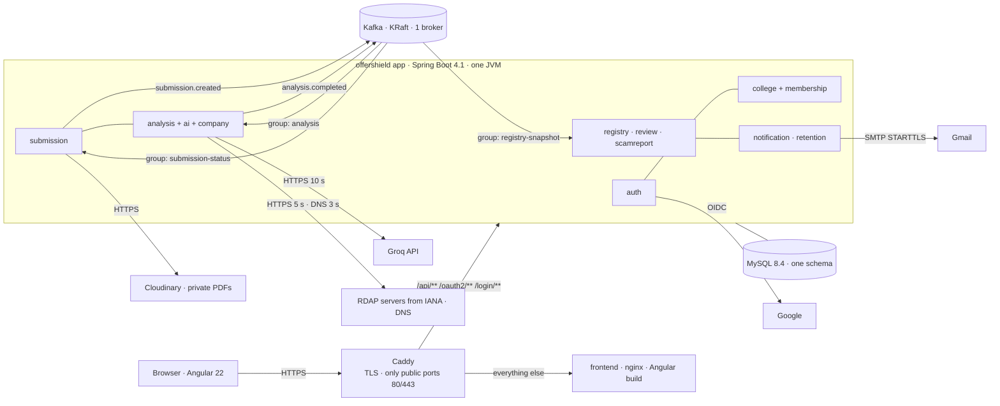

# OfferShield

**Check a suspicious job offer before you trust it.**

Upload a job offer letter (PDF or pasted text) and OfferShield gives you a **rule-based risk report**. Every point in the report shows its evidence and where that evidence came from.

- On-campus students can ask their placement officer (TPO) to review the report.
- Anyone can report a scam. An admin confirms reports into a shared scam registry, so a later letter with the same wording, sender domain, phone number or UPI ID is flagged for every user.

OfferShield is one Spring Boot app plus Kafka, MySQL and Angular, behind Caddy. It is built to run on a free Oracle Cloud VM.

> **OfferShield cannot prove that an offer is genuine.** A Low result only means that no major red flags were found.

## Contents

- [Why OfferShield exists](#why-offershield-exists)
- [Who it is for](#who-it-is-for)
- [How it works for a student](#how-it-works-for-a-student)
- [How the score is made](#how-the-score-is-made)
- [AI and its real capacity](#ai-and-its-real-capacity)
- [Architecture](#architecture)
- [Run it locally](#run-it-locally)
- [Environment variables](#environment-variables)
- [Deploy to Oracle Cloud](#deploy-to-oracle-cloud)
- [Security in plain words](#security-in-plain-words)
- [Tests](#tests)
- [Honest limitations](#honest-limitations)
- [Project status](#project-status)
- [More documentation](#more-documentation)

---

## Why OfferShield exists

Freshers in India receive fake job offers: forged offer letters, fake recruiters, and "pay a deposit to join" demands. Many of them can't tell these apart from real offers. Placement cells (TPOs) that do see offers have no structured way to check them, keep a record, or warn other students.

The PRD ([§1.1](OfferShield_PRD.md)) cites, among others:

- An Indeed report (July 2026, via [Business Today](https://www.businesstoday.in/jobs/story/more-than-9-in-10-job-seekers-encounter-fake-job-offers-542006-2026-07-09)): 93% of Indian employees and job seekers have encountered suspicious or fraudulent job opportunities, and 51% are not confident they can tell a genuine recruiter from a scammer.
- A documented case of fraudsters impersonating Ashok Leyland executives, who offered students jobs against a cash "security deposit" ([HRKatha](https://www.hrkatha.com/news/the-case-of-fake-ashok-leyland-appointment-letters/)).

> **This is an assumption, not a statistic (PRD §1.1).** Off-campus applicants *may* be scammed more often than on-campus ones, because no placement officer looks at their offers. No source we found measures this. Don't present it as a fact.

## Who it is for

| Who | How they get access | What they can do |
|---|---|---|
| **Student, off-campus** | Any Google account | Upload offers, read their own reports, report a scam, ask to join a college |
| **Student, on-campus** | Asks to join their college; the college's TPO approves the request | Everything above, plus **"Ask my TPO"** |
| **TPO** (placement officer) | The admin assigns the TPO's Google email to a college. That Google account then gets the TPO role | Approve or reject join requests for their college. Decide review cases (`CONFIRMED_SCAM`, `CONFIRMED_GENUINE` or `INCONCLUSIVE`) with a note |
| **Admin** | Their Google email is listed in `ADMIN_EMAILS` | Create colleges and assign TPOs. Confirm or reject scam reports, and revert a confirmation. Manage the list of known companies |

Roles are stored in the database and never trusted from the browser. Sign-in is Google only, with no passwords.

## How it works for a student

1. **Sign in with Google.**
2. **Send the letter.** Upload a PDF (up to 5 MB and 10 pages) or paste the text (up to 20,000 characters). Optionally add the sender's email, the recruiter's phone number and a UPI ID.
   - A PDF that is only an image (a scan) can't be read. Paste its text instead; there is no OCR.
3. **The app checks the file and starts the analysis.**
   - It checks the file, extracts the text and encrypts it.
   - It keeps the original PDF as a private file.
   - It answers at once. The analysis runs in the background, through Kafka.
4. **The page waits for the result.** It checks every 2 seconds. After 3 minutes it stops with "Still processing — check My submissions".
5. **Read the report:**
   - a score from 0 to 100
   - a band (Low, Medium or High) with a fixed message
   - every signal with its evidence and its source kind
   - an **"Explain simply"** button for a plain-language summary
6. **Next steps:**
   - Report the letter as a scam.
   - On-campus students can also ask their TPO to review it.

The letter text, the PDF and the report are deleted after **30 days**. The hashed scam markers (which contain no student data) and the records of TPO and admin decisions are kept.

## How the score is made

**Java code computes the score with fixed rules.** AI never scores (see [AI](#ai-and-its-real-capacity)). The weights below are **starting heuristics** (PRD §7.2). They are meant to be tuned later against real TPO and admin decisions.

### Where the evidence comes from (source kinds)

Every signal in the report shows one of these five source kinds.

| Kind | Source | Example | How it can be wrong |
|---|---|---|---|
| 1 | The document itself | "Pay ₹5,000 deposit", a gmail.com sender, WhatsApp-only contact | Unusual wording can slip past the rules |
| 2 | Public internet registries | Domain registration date (RDAP), MX and DMARC records (DNS) | Some country domains publish little RDAP data; an old domain can still be a scam |
| 3 | Curated lists | Known companies and their official domains, a list of free-mail domains | Only covers the companies the admin has added |
| 4 | Human-confirmed reports | A TPO or the admin confirmed a scam | People make mistakes; every decision is audit-logged, and the admin can revert a confirmation |
| 5 | User reports, not confirmed | Reports from other signed-in users | Can be false or malicious; low weight and never shown as fact |

### The checks

| Check | What it looks for | Kind | Effect |
|---|---|---|---|
| C1 Money request | Fees, deposits, registration or training charges, laptop costs, "refundable" (Hinglish variants included) | 1 | **Hard override → High** |
| C2 Free-mail sender | The sender uses a free-mail domain | 1 | +25 |
| C3 Wrong sender domain | The letter names a known company, but the sender isn't on one of its official domains | 3 | +20 |
| C4 Lookalike domain | The sender's domain imitates a known company (for example `inf0sys-careers.com`) | 3 | +30 |
| C5 Young domain | The sender's domain was registered recently (RDAP) | 2 | +20 if under 90 days, +10 if under 1 year |
| C6 Mail setup | Does the domain have an MX record? A DMARC record? (DNS) | 2 | +15 for no MX, +5 for no DMARC |
| C8 Off-platform contact only | Only a WhatsApp or Telegram number, no company email | 1 | +15 |
| C9 Pressure language | "Join within 24 hours", "no interview required", "limited seats" | 1 | +10 each, at most 2 |
| C10 Confirmed registry match | The sender domain, a phone number or a UPI ID matches a confirmed scam | 4 | **Hard override → High** |
| C11 Same wording as a confirmed scam | The letter's SimHash fingerprint is within 3 bits of a confirmed scam letter | 4 | **Hard override → High**, or only +20 with a warning when the sender uses an official domain of the company named in the letter (see the copied-letter guard below) |
| C12 Reports by other users | The letter matches scam reports that are not confirmed yet, counted by distinct people | 5 | +10 for 1–2 people, +25 for 3 or more. **Never an override** |

C7 (email header analysis) is deferred to a later version. The total is capped at 100.

### Bands and messages

These messages are shown word for word (PRD §7.2):

| Score | Band | Message |
|---|---|---|
| 0–24 | **Low** | "No major red flags found. This does not prove the offer is genuine." |
| 25–49 | **Medium** | "Warning signs. Verify through the company's official website or careers page." |
| 50 and above, or a hard override | **High** | "Strong scam indicators. Do not pay anything." |

### Two trust levels

Reports from users and human-confirmed scams are shown differently:

- **"Reported as a scam by N users (not verified)"** is a neutral label for reports that nobody has confirmed. These reports can raise the score a little, but they never force High and are never shown as fact.
- **"Confirmed scam"** means a TPO or the admin reviewed the evidence and confirmed it.

### Fairness rules

Wrongly accusing a real employer is the worst mistake this product can make. These rules guard against it:

- **Copied-letter guard.** Scammers often copy a genuine company's letter and change only the payment details. So C11 forces High **only when the sender is not on that company's official domain**. When the sender is official, the match is a +20 warning instead.
- **Shared domains never become scam markers.** This covers free-mail domains (like gmail.com) and the official domains of known companies.
- **"No fee" sentences don't count.** A sentence like "no registration fee is charged" never triggers C1 unless it names an amount. "No interview, pay ₹5,000 fee" still triggers it.
- **AI can only add risk.** It can never lower a score or remove a finding.

### Two layers, and how it improves

- **Layer 1: memory of past cases** (the registry, C10–C12). This catches repeat scams: the same letter, phone number or UPI ID sent to many students.
- **Layer 2: general red-flag rules** (C1–C9). These can catch new scams that nobody has reported yet.
- **How it improves:** when the admin sees a scam the rules missed, a person adds the new phrase or check. No machine-learning model is trained.

If a lookup fails (for example the domain registry doesn't answer in time) or the AI is unavailable, **the report still arrives**. It is marked `PARTIAL`, and the check that couldn't run is named.

## AI and its real capacity

OfferShield uses **Groq** (groq.com) as its only AI provider, on the free tier. Groq is not xAI's "Grok".

**What the AI does:**
- It **extracts** the company name, recruiter name, CTC, joining date, phone numbers, UPI IDs and payment mentions from the letter, as strict JSON.
- It **explains** a finished report in simple words when you click "Explain simply". The explanation is saved and reused.

**What the AI never does:**
- It never decides or lowers the score. Its findings are only candidates, and the rules then check them.
- It never adds facts that aren't in the letter. Every AI-derived field is labelled **"AI-extracted"** in the report.

**How the letter is protected:**
- Before anything is sent, phone numbers, emails, UPI IDs, long numbers and names after greetings or titles ("Dear …", "Mr. …", "Candidate Name: …") are **masked**.
- The letter goes in the user message between random delimiters, never in the system prompt.
- The answer must parse into a fixed record. Anything else is thrown away.
- The same letter is never sent twice (cache).

If every model fails or runs out of quota, the report still arrives, rule-only, and it says **"AI unavailable"**.

### Capacity

| What | Number | Status |
|---|---|---|
| Models, in order | `openai/gpt-oss-120b` → `openai/gpt-oss-20b` → `qwen/qwen3.8-27b` (Qwen is a Preview model) | Listed by Groq for the project's key, 2026-11-18 |
| Groq free limits, **per model** | 30 requests/min · 1,000 requests/day · 8,000 tokens/min · 200,000 tokens/day | Published by Groq, checked 2026-10-19 ([01 §6](docs/plan/01-prd-review-and-open-decisions.md), V-07) |
| Limits apply to | The whole Groq organization, not each key. Extra keys from one account add nothing, and multiple accounts are against Groq's terms | Published by Groq |
| Expected AI analyses per day | **About 230–300**, then rule-only "AI unavailable" | **Estimate** (decision D-11, [02 §11](docs/plan/02-system-architecture-and-adrs.md)) |
| Burst rate | About 4 calls per minute per model (the token-per-minute limit) | **Estimate** |
| Tokens per call | About 750 (≈ 544 prompt + 204 completion, of which ≈ 127 reasoning); max 855; about 1 s per call. Measured on 6 real `openai/gpt-oss-120b` extraction calls, 2026-11-18 (V-09). Identical letters reuse the cached answer and make no call | Measured |

The PRD's "about 1,300 analyses a day" assumed a second provider (Cerebras). Cerebras was dropped because its free tier is a card-required trial (D-11). "Explain simply" calls use the same Groq quota; each user can ask for at most 10 explanations per 10 minutes.

## Architecture

This diagram comes from [docs/plan/02 §1](docs/plan/02-system-architecture-and-adrs.md):



### Components

| Part | What it is | Job |
|---|---|---|
| **Caddy** | Web server, the only public entry | HTTPS certificates in production. Routes `/api`, `/oauth2` and `/login` to the app, and everything else to the frontend. Limits request sizes (6 MB for uploads, 1 MB elsewhere) |
| **frontend** | nginx serving the Angular 22 build | The user interface: standalone components, signals, custom CSS |
| **app** | **One** Spring Boot 4.1 app (Java 21) | All the features, as packages: `auth`, `college`, `membership`, `submission`, `analysis`, `ai`, `company`, `registry`, `review`, `scamreport`, `notification`, `retention`, `common` |
| **Kafka** | Apache Kafka 4.3.1 (KRaft, one broker) | Runs the analysis in the background. Two topics: `submission.created` and `analysis.completed` |
| **MySQL 8.4** | Database | One schema with Flyway migrations, and one app database user (not root) |
| **Groq** | External AI API | Extraction and "Explain simply" only, never scoring |
| **Cloudinary** | External file storage (free plan) | Stores the original PDFs as **private** files (Cloudinary's `authenticated` delivery type, so no unsigned link works). Signed links that last 5 minutes are given only to the TPO of the case or the admin |
| **Gmail SMTP** | A dedicated free Gmail account | Sends emails about join decisions, TPO review decisions and admin decisions on scam reports |
| **Google** | Sign-in (OpenID Connect) | The only way to sign in |
| **RDAP and DNS** | Public internet registries | Domain age (C5) and mail setup (C6) |

Not used, by decision: an API gateway, Redis, Resilience4j, a home-made JWT, a second AI provider, roster CSV upload, and domain auto-join.

### How the background analysis stays reliable

- An upload is saved first. The `submission.created` event is published only **after the database commit**, and the app waits for Kafka to confirm the send.
- If the event is lost, a sweeper re-sends it, waiting 2, 4, 8 and then 16 minutes between tries. After that the submission is marked `FAILED`.
- Every consumer remembers the events it has handled (`processed_event`), so duplicates do no harm.
- A failing message is retried 3 times. After that it goes to a dead-letter topic (`<topic>.DLT`).
- `analysis.completed` goes to two consumer groups: one updates the submission status, the other stores the evidence snapshot that TPOs and the admin see.

### Repository layout

```text
backend/                   Spring Boot app (one Maven module, Maven Wrapper included)
frontend/                  Angular 22 app (+ nginx config)
infra/mysql/init/          creates the app's database user on first start
docs/plan/                 decisions, architecture, roadmap, tasks, tests, deployment
docs/deploy/               step-by-step Oracle Cloud guide
docker-compose.yml         local stack (5 containers)
docker-compose.prod.yml    production overrides (HTTPS, memory limits, log rotation)
Caddyfile                  routing, security headers, body limits
.env.example               the configuration names (copy to .env)
OfferShield_PRD.md         the product requirements document
```

## Run it locally

### What you need

- **Docker Desktop** (running), with Docker Compose.
- **Git.** On Windows, use **Git Bash** for the commands below. It also includes `openssl`.
- Only to run the tests outside Docker: **JDK 21** and **Node 24 LTS**. Maven is downloaded by the wrapper (`backend/mvnw`).

### Steps

1. **Get the code and create your `.env`:**

   ```bash
   git clone <this repository's URL> OfferShield
   cd OfferShield
   cp .env.example .env
   ```

2. **Fill in `.env`** (see [Environment variables](#environment-variables)).
   - The stack **refuses to start** without `MYSQL_ROOT_PASSWORD`, `DB_PASSWORD`, `TEXT_AES_KEY_BASE64` and `INDICATOR_HMAC_PEPPER`.
   - To sign in, you also need `GOOGLE_CLIENT_ID`, `GOOGLE_CLIENT_SECRET` and your email in `ADMIN_EMAILS`.
   - `.env` is git-ignored. Never commit it, paste it anywhere or print it.

3. **In the Google Cloud Console**, add this redirect URI to your OAuth client: `http://localhost/login/oauth2/code/google`

4. **Build and start everything:**

   ```bash
   docker compose up -d --build
   docker compose ps          # wait until all 5 containers say "healthy"
   ```

5. **Open <http://localhost>** and sign in with Google.

### Useful commands (from [06 §3](docs/plan/06-deployment-and-verification.md))

| What | Command | Notes |
|---|---|---|
| App log | `tail -f logs/offershield.log` | Request ID, `class.method` and duration only; no personal data |
| Kafka topics | `docker compose exec kafka /opt/kafka/bin/kafka-topics.sh --bootstrap-server localhost:9092 --list` | `submission.created`, `analysis.completed` and their 2 `.DLT` topics |
| After editing the Caddyfile | `docker compose restart caddy` | Caddy doesn't reload the file on its own |
| Stop (keep data) | `docker compose stop` | |
| **Reset** | `docker compose down -v` | **Deletes all local data.** Use only on purpose |

Locally, Caddy listens on `127.0.0.1:80` only, so the app isn't reachable from other machines.

## Environment variables

Only the **names** are listed here. Values go in the git-ignored `.env` (template: [.env.example](.env.example)). Every service below is free. No card is needed, except for Oracle Cloud signup, where the card is for identity only (see [Deploy](#deploy-to-oracle-cloud)).

| Variable | Needed? | Where to get it |
|---|---|---|
| `GOOGLE_CLIENT_ID`, `GOOGLE_CLIENT_SECRET` | To sign in | Google Cloud Console → Credentials → OAuth client (type *Web application*). Redirect URIs: `http://localhost/login/oauth2/code/google`, and later `https://<name>.duckdns.org/login/oauth2/code/google` |
| `APP_BASE_URL` | Yes | `http://localhost` locally. In production, your `https://` DuckDNS address |
| `APP_DOMAIN` | Production only | Your free [DuckDNS](https://www.duckdns.org) name, for example `<name>.duckdns.org`. Leave it empty locally |
| `ADMIN_EMAILS` | To have an admin | Your own Google email address(es) |
| `TEXT_AES_KEY_BASE64` | **Required** | Generate with `openssl rand -base64 32` (must decode to 32 bytes) |
| `INDICATOR_HMAC_PEPPER` | **Required** | Generate with `openssl rand -base64 48` |
| `MYSQL_ROOT_PASSWORD`, `DB_PASSWORD` | **Required** | Generate each with `openssl rand -base64 24`. `DB_PASSWORD` belongs to the app's database user |
| `KAFKA_BOOTSTRAP` | Yes | Keep the value from `.env.example` |
| `GROQ_API_KEYS` | Optional | [console.groq.com](https://console.groq.com) (free, no card; one account only). Turn on Zero Data Retention there. Empty = AI off ("AI unavailable") |
| `AI_CHAIN` | Optional | Keep the value from `.env.example` (the three Groq models in order) |
| `CLOUDINARY_URL` | Optional | A free [Cloudinary](https://cloudinary.com) account (no card) → API environment variable. Optional extra hardening: Settings → Security → "Strict transformations". Empty = the PDF isn't kept (the text still is) |
| `SMTP_USERNAME`, `SMTP_APP_PASSWORD` | Optional | A **dedicated** Gmail account → turn on 2-Step Verification → create an App password. Empty = no emails (decisions still save) |

**Back up `TEXT_AES_KEY_BASE64` and `INDICATOR_HMAC_PEPPER` offline**, for example in a password manager. If you lose them, the stored letters can't be read and the existing scam markers stop matching.

## Deploy to Oracle Cloud

Follow the beginner guide: **[docs/deploy/oci-step-by-step.md](docs/deploy/oci-step-by-step.md)**. It covers:

- the Oracle Cloud account (Always Free)
- an Ubuntu arm64 VM (1 OCPU / 6 GB plus 2 GB swap recommended; 2 OCPU / 12 GB also fits)
- both firewall layers
- Docker
- a free DuckDNS name
- the production `.env`
- Google sign-in for production
- a post-deploy checklist

In short, production runs the same containers with one extra compose file:

```bash
docker compose -f docker-compose.yml -f docker-compose.prod.yml up -d --build
```

- Caddy then serves `https://<name>.duckdns.org` with an automatic certificate.
- The production file sets memory limits: app 1 GB, MySQL 1.5 GB, Kafka 1 GB, Caddy and nginx 128 MB each.
- The production file also turns on log rotation.
- On the local stack, the containers used about 1.57 GiB of memory when idle (measured 2026-11-18, without limits).
- Oracle's signup asks for a card, but only for identity. Nothing is charged on Always Free. Never click "Upgrade".
- The fallback is any Linux VM with about 4 GB of RAM or more and Docker, using the same two compose files (guide §18).

## Security in plain words

Security is a core feature of this project. These rules are never cut (PRD §14, decision D-25).

**Sign-in and sessions**
- You sign in with Google only, so there are no passwords to leak.
- Users are identified by Google's permanent account ID (`sub`), never by email.
- Who you are comes **only from the server-side session**. Request headers are never trusted for identity.
- An email that Google hasn't confirmed can still sign in, but it can never become admin or TPO, and it can't join a college.
- The session cookie is `HttpOnly`, `Secure` and `SameSite=Lax`, and it lasts 4 hours. JavaScript can't read it.
- Every change needs a CSRF token (the `XSRF-TOKEN` cookie, which Angular sends back automatically).

**Who can see what**
- Every database lookup is limited to the owner (or to the TPO's own college).
- Someone else's letter, report or PDF link gives **404**, exactly as if it didn't exist. A wrong role gives **403**.

**Uploads**
- A PDF must be at most 5 MB and 10 pages, and must really be a PDF (checked by its bytes, not its name).
- Reading a PDF has memory limits and a 10-second timeout, as protection against "PDF bombs".
- Only the text is extracted. The PDF is never rendered or opened beyond that.
- The PDF goes to Cloudinary only after these checks, as a **private** file. Without a signed link, Cloudinary refuses both the file and any rendered page of it.
- Signed download links last 5 minutes and are given only to the TPO of the case or the admin.

**Outbound requests (SSRF)**
- The app looks up domains that users type in. Only a cleaned-up, valid domain name reaches the RDAP or DNS lookup.
- IP addresses, ports, paths, schemes and `localhost` are refused.
- RDAP servers come only from IANA's official list.
- **A link found inside a letter is never fetched.**

**Data protection**
- Letter text is encrypted with AES-256-GCM.
- Phone numbers and UPI IDs are stored only as HMAC-SHA256 hashes with a secret pepper.
- Personal details are masked before anything is sent to the AI.
- Letters, PDFs and reports are deleted after 30 days.
- Every TPO and admin decision is written to an audit log.
- The log records IDs, method names, timings and a request ID. It **never** records letter text, emails, phone numbers, UPI IDs or tokens.
- The design follows the data-minimisation ideas of India's DPDP Act, 2023. This is not legal advice; check the current rules before a public launch.

**Platform**
- Only Caddy publishes ports. The app, MySQL and Kafka are reachable only inside the Docker network.
- Security headers are set: CSP, HSTS, `nosniff`, `frame-ancestors 'none'` and a Referrer-Policy.
- Spring Boot Actuator exposes only `health`.
- Secrets live only in the git-ignored `.env`. CI runs **gitleaks**, and Dependabot watches the dependencies.
- Angular escapes all output, and `innerHTML` is never used (CI checks this).

**Abuse limits**
- Uploads: 5 per 10 minutes per user.
- Scam reports: 5 per day per user.
- All requests: 60 per minute per signed-in user.
- Each user can read only one PDF at a time.

The OWASP Top 10 (2021) mapping is in PRD §14.8 and [05 §6](docs/plan/05-testing-and-security-plan.md).

## Tests

```bash
# Backend: unit + integration tests (Docker must be running: DB tests use a real MySQL 8.4 via Testcontainers, no H2)
backend/mvnw -B -f backend/pom.xml verify          # Windows PowerShell: backend\mvnw.cmd -B -f backend\pom.xml verify

# Frontend: Vitest unit tests, then a production build
cd frontend && npm ci && npx ng test --watch=false && npx ng build

# Whole stack
docker compose up -d --build && docker compose ps
```

**Latest full runs** (from the results log, [05 §7](docs/plan/05-testing-and-security-plan.md)):

| Suite | Result | Measured |
|---|---|---|
| Backend, Maven `test` phase (unit, web-slice and MySQL tests) | 1,075 tests, 0 failures, 0 errors, 0 skipped | 2026-11-18 |
| Backend, Maven `integration-test` phase (`*IT` classes) | 94 tests, 0 failures, 0 errors, 0 skipped | 2026-11-18 |
| Frontend (`npx ng test`) | 414 tests in 39 files, all passing; `npx ng build` OK | 2026-10-21 (no frontend change since) |


**What the tests cover:**
- The seven tests the PRD requires (§18): `ScoringEngineTest`, `DomainValidatorTest`, `SubmissionAccessTest`, `LlmChainTest`, `PromptInjectionTest`, `SimHashTest` and `CopiedLetterGuardTest`.
- Security tests for IDOR, SSRF, CSRF, uploads, cookies, headers, rate limits and "no personal data in logs".
- One test per risky rule.

External services (Google, Groq, Cloudinary, Gmail, RDAP, DNS) are replaced by local stubs or mocks. All test letters are **fake**; never use real students' documents.

CI ([.github/workflows/ci.yml](.github/workflows/ci.yml)) runs on every push and pull request:
- the backend `verify`
- the frontend tests and build
- the frontend Docker build
- an `innerHTML` check
- a check that the Caddyfile and the app send the same CSP
- gitleaks

## Honest limitations

PRD §19, adjusted for the decisions that changed the design (D-11, D-16, D-21; see [01 §1](docs/plan/01-prd-review-and-open-decisions.md)):

1. **It can't prove an offer is genuine.** A careful scammer with an old domain and proper DNS records can score Low. The app never calls an offer genuine; even the Low message says it does not prove that.
2. **The scoring weights are not validated.** They are starting heuristics until there is labelled data from TPO and admin decisions.
3. **User reports can be wrong or malicious.** That's why they are labelled "Reported as a scam by N users (not verified)", weighted low, and can never force High.
4. **Lookalike detection only covers companies in the known-company list.** The admin maintains one global list. Very short brand names (under 5 letters, like TCS or IBM) are not used for lookalike matching, to avoid flagging unrelated firms.
5. **The registry starts empty.** Layer 1 grows only as TPOs and the admin confirm cases. For demos, seed it with your own fake scam letters. Never load real people's phone numbers from news articles.
6. **A scam rewritten from scratch won't match the SimHash fingerprint.** Only the rules, and any shared phone number, UPI ID or domain, will catch it.
7. **Free tiers change without notice.** Oracle halved its free ARM allowance in 2026. Groq's free limits are published per model and can change. OfferShield uses **Groq only** (D-11); the PRD's second provider, Cerebras, was dropped because its "free" tier is a card-required trial. The free-tier facts were checked on 2026-10-19.
8. **One app, one database user (D-16).** The PRD's microservices, API gateway and trusted identity headers were replaced by one Spring Boot app. Identity comes only from the session, so no headers are trusted. The trade-offs:
   - One database user (`offershield_app`, not root) owns the whole schema. A bug in one feature could touch another feature's tables; the "each feature uses only its own tables" rule is a code convention, not a database permission.
   - The features can't be scaled or deployed separately.
9. **Sessions live in the app's memory (D-21).** Instead of the PRD's own JWTs, OfferShield uses Spring Security's standard session cookie. Logout really ends the session, which a JWT couldn't do before it expired. The trade-offs:
   - **Restarting the app signs everyone out.**
   - Only one app instance can run.
10. **Gmail SMTP emails may land in spam.** Gmail also allows at most 500 emails or recipients a day.
11. **The off-campus risk claim is an assumption** (PRD §1.1), so don't present it as a statistic.

Also:

- **No backups in v1** (risk K-08). Nightly database backups were not chosen. Everything runs on a single VM, and losing that VM loses the data. Backups can be added later.
- **AI masking isn't perfect.** A name with no greeting, title or label before it (for example, only in a signature) can still reach Groq.
- **Scanned (image-only) PDFs can't be read.** There is no OCR, so the student must paste the text.

## Project status

Status as of **2026-11-18**. Every check is recorded in [05 §7](docs/plan/05-testing-and-security-plan.md), with "executed" and "passed" kept separate.

- **Done:**
  - Phases P1–P13: all features, the review fixes and the local test runs ([Tests](#tests)).
  - Live end-to-end run on a throwaway local stack (2026-11-18). A mock sign-in server stood in for Google; Groq, Cloudinary, Gmail, RDAP and DNS were real. It covered:
    - the user journeys for students, the TPO and the admin
    - the live security proofs for cookies, IDOR, CSRF, SSRF, file checks, rate limits, no personal data in logs, and encryption at rest
    - the failure drills: bad AI key, lookups down, app killed, Kafka down, malformed event, two TPOs deciding at once
  - That run found one defect: a rendered page of a private PDF could be fetched without a signature. It was fixed (Cloudinary `authenticated` delivery type) and re-checked live.
  - Google itself accepts the real client ID and secret.
- **Pending:**
  - A real human Google sign-in.
  - Adding the researched known-company list in the real database (after the first admin sign-in).
  - The Oracle Cloud deployment (P14; the guide is ready).

No performance numbers are claimed, because none have been measured yet.

## More documentation

| Document | What's in it |
|---|---|
| [OfferShield_PRD.md](OfferShield_PRD.md) | The product requirements (never edited; the decisions below win where they differ) |
| [docs/plan/00-prd-coverage-matrix.md](docs/plan/00-prd-coverage-matrix.md) | Where each PRD requirement is handled |
| [docs/plan/01-prd-review-and-open-decisions.md](docs/plan/01-prd-review-and-open-decisions.md) | Approved decisions D-01…D-33, checked external facts, risks |
| [docs/plan/02-system-architecture-and-adrs.md](docs/plan/02-system-architecture-and-adrs.md) | Architecture, data model, Kafka events, API shapes, ADRs |
| [docs/plan/03-implementation-roadmap.md](docs/plan/03-implementation-roadmap.md) | Phases and milestones |
| [docs/plan/04-work-breakdown.md](docs/plan/04-work-breakdown.md) | Tasks with acceptance criteria |
| [docs/plan/05-testing-and-security-plan.md](docs/plan/05-testing-and-security-plan.md) | Test plan, security proofs, results log |
| [docs/plan/06-deployment-and-verification.md](docs/plan/06-deployment-and-verification.md) | Secrets, local workflow, operations checks |
| [docs/plan/07-phase-execution-prompts.md](docs/plan/07-phase-execution-prompts.md) | The per-phase build prompts |
| [docs/deploy/oci-step-by-step.md](docs/deploy/oci-step-by-step.md) | Oracle Cloud deployment, step by step |
| [CLAUDE.md](CLAUDE.md) | Project rules and security invariants |
