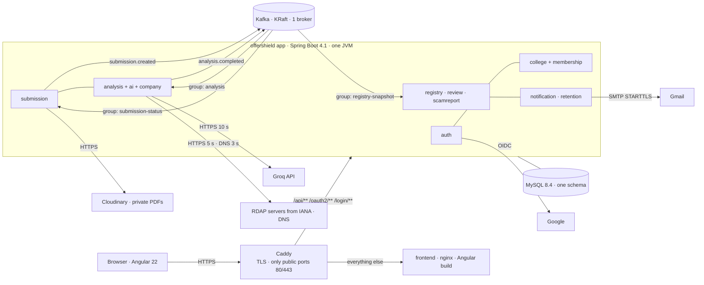
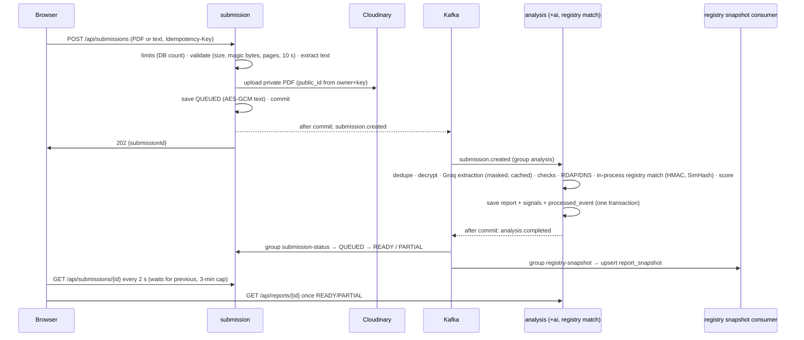
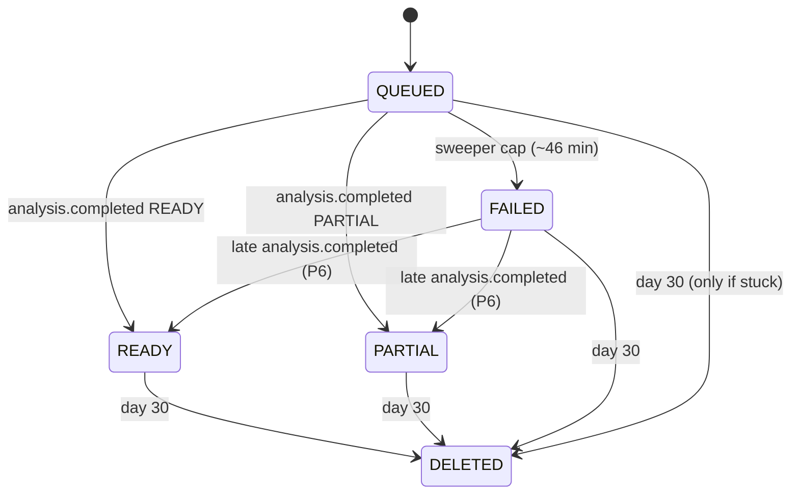

# 02 — System Architecture and ADRs (future v1 system)

**Status:** blueprint, nothing built yet. It follows the decisions in [01 §1](01-prd-review-and-open-decisions.md): **one Spring Boot app plus Kafka** (D-16), not the PRD's 4 microservices. The PRD's features, checks, data and security rules are kept except where a decision says otherwise.

---

## 1. Topology



- Only **Caddy** publishes ports. The app, MySQL and Kafka are reachable only inside the Docker network.
- Caddy does the routing the PRD gave the gateway, both locally (`http://localhost`, M-03) and in production (`https://<name>.duckdns.org`). Browser, API and login are therefore always on **one origin**, so cookies and CSRF work the same everywhere.

## 2. Feature packages (modular monolith)

Base package `com.offershield` (M-02). Each feature owns its tables and exposes a service; other features call that service, never its repository. This keeps the PRD's boundaries (§5.3) inside one app.

| Package | Responsibility (PRD) | Owns tables |
|---|---|---|
| `auth` | Google OIDC login; provision the user by `sub`; `ADMIN_EMAILS`; TPO pre-assignment (D-02); session, CSRF, security headers; Bucket4j limit (D-12); `/api/auth/me`, logout (§6.1, §14.1–14.2) | `app_user`, `tpo_assignment` |
| `college`, `membership` | Admin creates colleges and assigns TPOs; student join request; TPO approve/reject with If-Match (§3.1 path C, §11) | `college`, `membership` |
| `submission` | Upload (PDF/text), validation, AES-GCM text, Cloudinary private PDF, Idempotency-Key, DB-count limit, publish `submission.created` after commit, sweeper, status consumer, owner reads (§4 F3, §6.2–6.3, §14.4) | `submission` |
| `analysis` | `submission.created` consumer; checks C1–C6, C8–C12; SSRF guard; RDAP/DNS clients; scoring; report; publish `analysis.completed`; SimHash computation (§7, §10.1) | `report`, `signal` |
| `ai` | Groq model chain, 429 handling, redaction (D-07), extraction, cache, "Explain simply" (§8); public API: `ExtractionService.extract`, `ExplainService.explain` | `llm_cache` (V12) |
| `company` | Admin-only global known-company list (D-24); public API: `KnownCompanies.directory()` / `isOfficialDomain()` (cached read side for C3/C4 and the P9 shared-domain guard) | `known_company`, `known_company_domain` |
| `registry` | `analysis.completed` snapshot consumer (group `registry-snapshot`); indicators; HMAC (`IndicatorHasher`); exact + SimHash matching (`MatchService`, called in-process by `analysis`, R-F); shared-domain guard (D-08, `SharedDomains`); report / confirm / reject / revert (D-13) for P10 (`IndicatorService`); snapshot reads (`ReportSnapshotService`) (§4 F7, §10.1) | `report_snapshot`, `indicator`, `indicator_reporter` (V17–V19) |
| `scamreport` | Report scam; admin queue confirm/reject; PDF download link for admin (§6.4, D-05); calls `registry` (`IndicatorService`, `EvidenceService`) and `submission.PdfLinkService` (P10) | `scam_report` (V20) |
| `review` | Ask my TPO; TPO queue/decision with If-Match; PDF download link for TPO (§6.5, D-05); `registry` also serves `GET /api/registry/domains/{domain}` and the admin Revert (P10) | `review_case` (V21) |
| `notification` | Gmail emails sent right after commit (D-22) | — |
| `retention` | Daily 30-day cleanup (D-06, P11): `RetentionJob` (03:30 Asia/Kolkata) → `RetentionService` calls the owners' services: `submission.SubmissionRetention` (find expired, delete the private PDF outside any transaction, wipe the row), `ReportService.deleteForSubmissions`, `ReportSnapshotService.findSubmissionIds`/`delete` (held while a case or scam report is OPEN or decided < 30 days ago: `ReviewService`/`ScamReportService.stillNeedEvidence`), `ScamReportService.wipeDescriptionsDecidedBefore`, `LlmCache.deleteCreatedBefore`, `ProcessedEvents.deleteProcessedBefore` | — |
| `common` | ProblemDetail handler, `AuditLog`, `CurrentUser`, AOP logging aspect + request ID (D-27), `TextCipher`, Kafka config, `processed_event`, `FreeMailDomains` (the D-08 free-mail list, moved here in P8) | `audit_log`, `processed_event` |

## 3. Main flow: upload → report



## 4. Data model (one MySQL 8.4 schema, Flyway)

Conventions as in PRD §10: `BINARY(16)` UUIDs, `created_at`/`updated_at`, InnoDB, `utf8mb4`. Tables follow PRD §10, with these changes:

| Table | Change vs PRD §10 | Reason |
|---|---|---|
| `college_domain`, `roster_entry` | **Removed** | D-17 |
| `membership.method` | Removed (always MANUAL) | D-17 |
| `tpo_assignment(email UNIQUE, college_id, assigned_by)` | **Added** | D-02 |
| `submission` | + `publish_attempts`, `last_published_at`; statuses `QUEUED/READY/PARTIAL/FAILED/DELETED`; + `request_sha256` (Idempotency-Key replay check); `sender_email`/`extra_phone`/`extra_upi` are kept only inside the AES-GCM `contacts_cipher` (P5) | D-28, D-06, D-33.2 |
| `report` | + `hard_override`, `sender_domain` (P6; only a domain that passed the SSRF guard); + `simhash`, `phone_hmacs`, `upi_hmacs` (JSON), `indicators_complete`, `reported_by` (P9, V16) | Re-send fix (D-28) |
| `signal` | Named **`report_signal`** (`SIGNAL` is reserved in MySQL); one `evidence VARCHAR(200)` instead of `evidence_json`; + `hard_override`; UNIQUE (`report_id`, `check_code`) (P6) | 02 §5 has one evidence string per signal |
| `known_company.college_id` | Removed (global only); `known_company_domain.domain` unique overall, registrable lower-case ASCII (P8: V14, V15, no seed rows) | D-24, D-08 |
| `report_snapshot` | + `signals_json` (the report's signals, evidence masked), `indicators_complete`, `partial`, `hard_override`, `completed_at`; `domain` = the **registrable** sender domain (only one that passes the SSRF guard); `simhash` signed `BIGINT` (same 64 bits); FK `submission_id` → submission (P9, V17) | D-04 |
| `indicator` | `value_text`/`value_hash` → one `match_key` (domain, HMAC hex or 16-hex SimHash), UNIQUE (`type`, `match_key`); `simhash` only for SIMHASH; + `version` (Revert If-Match), `confirmed_at`; `display_hint` dropped (P9, V18) | One race-free upsert key |
| `indicator_reporter` | PK (`indicator_id`, `user_id`, `submission_id`); counts are `COUNT(DISTINCT user_id)` (P9, V19) | D-33.4 reject removes exactly one report; D-33.5 |
| `scam_report` | + `version`; `description` → `description_cipher` (AES-GCM, AAD `<id>:description`) + `key_version`; `amount_asked` INT rupees; + `decided_at` (P10, V20); `description_cipher` nullable, wiped 30 days after the decision (P11, V22) | If-Match (§13.8); §14.6 (descriptions hold phones/UPI IDs) |
| `review_case` | `decision` → `status` (OPEN + the three decisions); + `decided_at` (P10, V21) | One column for the state machine (02 §7) |
| `audit_log` | One shared table for every TPO/admin decision | R-E |
| `processed_event` | PK (`consumer`, `event_id`), + `processed_at` | 3 consumer groups in one app |

One DB user `offershield_app` (not root) owns the schema. Root is used only by the MySQL init script.

## 5. Kafka (D-20, D-28)

**Envelope** (JSON value; Kafka headers carry `eventId`, `eventType` and `requestId`):

```json
{ "eventId": "uuid", "eventType": "submission.created", "schemaVersion": 1,
  "occurredAt": "2026-10-19T10:00:00Z", "requestId": "uuid", "payload": { } }
```

| Topic · key · partitions | Consumers (group) | Payload v1 |
|---|---|---|
| `submission.created` · submissionId · 3 | `analysis` | submissionId, ownerUserId, collegeId?, sourceType, contentSha256 (IDs and metadata only, decided at P5: the text **and** the typed sender email, phone and UPI ID stay encrypted in the DB; the consumer loads them by ID with `SubmissionService.findContent`) |
| `analysis.completed` · submissionId · 3 | `submission-status`, `registry-snapshot` | submissionId, ownerUserId, collegeId?, outcome (READY/PARTIAL), score, band, hardOverride, unavailableChecks[], signals[{code, outcome, points, hardOverride, explanation, evidence ≤ 200 chars (contacts masked), sourceKind, aiExtracted}], senderDomain? (P6); phoneHmacs[], upiHmacs[] (HMAC-SHA256 lower-case hex, never raw values), simhash? (signed 64-bit), indicatorsComplete (Boolean; absent in pre-P9 events = false) (P9, additive) |

Rules:
- **Publish** in `@TransactionalEventListener(AFTER_COMMIT)`, confirming the send. Producers use `acks=all` with idempotence on.
- **Event IDs** are deterministic: a name-based UUID of topic + submissionId.
- **Sweeper** (`@Scheduled` every 60 s): re-publish `QUEUED` rows when `last_published_at` is older than 2^(attempts+1) min (2, 4, 8, 16 min). After 4 re-publishes → `FAILED`. A re-publish counts only once the broker confirmed it (P13), so a refused publish is retried the next minute without moving the row towards `FAILED`.
- **Consumers:**
  - `ErrorHandlingDeserializer` + JSON with trusted package `com.offershield.common.events` only.
  - `DefaultErrorHandler`: 3 retries with backoff, then `<topic>.DLT`, with the resolver set **explicitly**, because the Spring Kafka 4 default is `-dlt`.
  - Bad payloads are not retried.
  - analysis uses `max.poll.records=1`.
- **Idempotency:** insert (`consumer`, `eventId`) into `processed_event` in the same transaction as the work. If analysis receives a duplicate and the report already exists, it **re-sends** `analysis.completed`.
- **Retention:** topics keep messages 3 days and DLTs 7 days (D-06). Topics and DLTs are declared as `NewTopic` beans; auto-create is off.
- **Versioning:** additive fields keep `schemaVersion`; a breaking change gets a new topic (`.v2`).

**Report API (P6, for P12):** `GET /api/reports/{submissionId}`, owner only (404 for anyone else, an unknown ID, or a submission not analysed yet):

```json
{ "submissionId": "uuid", "score": 30, "band": "HIGH",
  "bandMessage": "Strong scam indicators. Do not pay anything.",
  "hardOverride": true, "partial": true, "aiUsed": false, "aiDetails": null, "senderDomain": "young-firm.com",
  "unavailableChecks": ["C5"],
  "signals": [
    { "code": "C1", "title": "Money request", "outcome": "TRIGGERED", "points": 0, "hardOverride": true,
      "explanation": "The letter asks you to pay money, …", "evidence": "pay Rs. 5,000 refundable security deposit …",
      "sourceKind": 1, "aiExtracted": false },
    { "code": "C5", "title": "Young domain", "outcome": "UNAVAILABLE", "points": 0, "hardOverride": false,
      "explanation": "The domain registry gave no usable registration date …", "evidence": null,
      "sourceKind": 2, "aiExtracted": false } ],
  "createdAt": "2026-10-20T10:00:05Z" }
```

`band` is LOW/MEDIUM/HIGH and `bandMessage` the PRD §7.2 text verbatim; `score` is the capped sum of points (an override adds none, so High can come with a low score: show `hardOverride`); signals come in check order with `outcome` TRIGGERED/PASSED/UNAVAILABLE/NOT_APPLICABLE; `evidence` is null unless triggered and has emails, UPI IDs and phones masked; `senderDomain` is null when the sender failed the SSRF guard.

**P7 additions (for P12):**
- `aiUsed: false` means **"AI unavailable"** (Groq off, every model failed, or its answer was invalid); the report is then also `partial: true` (PRD §2.1 pillar 4). Show "AI unavailable" next to the report, not as a failed check.
- `aiDetails` is `null` or `{ "label": "AI-extracted", "companyName": "Northwind Careers Pvt Ltd", "recruiterName": null, "ctc": "6,00,000 per annum", "joiningDate": "1 November 2026" }`: facts the AI read in the letter (each found in the letter, ≤ 100 characters, any may be null). Always show them under the "AI-extracted" label; they never affect the score.
- A signal with `aiExtracted: true` (so far only C1, when the money rule fired on a sentence the AI pointed at) gets an "AI-extracted" tag next to its source kind; its `explanation` starts with "AI-extracted:".

**Explain API (P7-03, for P12):** `POST /api/reports/{submissionId}/explain`, owner only (404 for anyone else, an unknown ID, or a submission not analysed yet), XSRF header required, no body. Always `200` while the report exists, even when the AI is down:

```json
{ "submissionId": "uuid",
  "explanation": "This letter shows strong scam signs: it asks you to pay a refundable deposit … never pay money to get a job.",
  "aiWritten": true }
```

- `aiWritten: true`: written by Groq from the report's signals (never the letter), checked (40–1,200 characters; no "verified/safe/legit/guaranteed"; no link, contact detail or placeholder), and saved in `report.explanation`: every later call returns the same text without an AI call. Label it "AI-written summary".
- `aiWritten: false`: AI unavailable or its answer broke a rule, so the text is a fixed template from the signals (band message, then "What the checks found:" with one "- Title: explanation" line per red flag, the checks that could not run, and the closing advice). It is not saved, so a later click can still get an AI-written one (P13: the same template is returned for 10 minutes before the AI is asked again). Label it "Summary from the checks (AI unavailable)".
- `explanation` is plain text with `\n` line breaks: render it as text (`white-space: pre-line`), never as HTML.

**Known-company API (P8-01, for the P12 admin screen):** ADMIN only (USER/TPO → 403 `FORBIDDEN`, anonymous → 401), XSRF header on every change. The list starts empty (no seed rows until V-21).

| Call | Body | Success | Errors (`errorCode`) |
|---|---|---|---|
| `GET /api/known-companies` | — | `200` array, ordered by name | — |
| `POST /api/known-companies` | `{ "name": "Infosys", "domains": ["infosys.com", "careers.infosys.co.in"] }` | `201` company | 400 `VALIDATION_FAILED` (name 2–100 chars of letters, digits, spaces, `& . , ' ( ) -`; 1–10 non-blank domains) · 400 `INVALID_DOMAIN` · 422 `FREE_MAIL_DOMAIN` · 409 `COMPANY_EXISTS` · 409 `DOMAIN_TAKEN` |
| `DELETE /api/known-companies/{id}` | — | `204` | 404 `NOT_FOUND` |
| `POST /api/known-companies/{id}/domains` | `{ "domain": "infosys.co.in" }` | `200` company | 400 `INVALID_DOMAIN` · 422 `FREE_MAIL_DOMAIN` · 422 `TOO_MANY_DOMAINS` (max 10) · 409 `DOMAIN_TAKEN` · 404 `NOT_FOUND` |
| `DELETE /api/known-companies/{id}/domains/{domain}` | — | `200` company | 409 `LAST_DOMAIN` (delete the company instead) · 404 `NOT_FOUND` |

```json
{ "id": "uuid", "name": "Infosys", "domains": ["infosys.co.in", "infosys.com"] }
```

- `domains` are stored and returned as **registrable domains in lower-case ASCII**, sorted (`careers.infosys.co.in` → `infosys.co.in`; an IDN comes back as punycode `xn--…`). Show them as returned; a domain belongs to one company only.
- `name` is trimmed with spaces collapsed; it is unique ignoring case and accents.

**P8 report signals (for P12):** C3 "Domain doesn't match the company" (+20) and C4 "Lookalike domain" (+30), both source kind 3 (curated list). NOT_APPLICABLE while the known-company list is empty, without a public sender domain, or for a free-mail sender (C2 counts that). C3 with `aiExtracted: true` (explanation starting "AI-extracted:") means the company came from the AI's reading of the letter, not from the rules. Evidence examples: C3 `Letter names Northwind Analytics; sent from n0rthwind-analytics.com; official domains: northwind-analytics.com`; C4 `inf0sys-careers.com looks like Infosys; official domains: infosys.com` (an IDN sender is shown as `іnfosys.com (xn--…)`).

**P9 report additions (for P12):** a new top-level `registry` object, placed between `unavailableChecks` and `signals`, and three signals in check order after C9. HMAC keys and the SimHash never appear in the API.

```json
"registry": { "confirmedScam": true, "wordingWarning": false, "reportedBy": 0 }
```

- `confirmedScam: true` → C10 or C11 forced High from a marker a TPO or the admin **confirmed**: show the **"Confirmed scam"** badge (source kind 4).
- `wordingWarning: true` → C11 matched a confirmed letter but the sender is the official domain of the company the letter names: +20, show "Wording resembles a reported scam" as a warning, **not** as "Confirmed scam".
- `reportedBy: N > 0` → C12: show **"Reported as a scam by N users (not verified)"** ("1 user" when N = 1), visually distinct from "Confirmed scam" and never as fact (source kind 5). 0 = no unconfirmed reports.

| Signal | Title | Outcomes | Example |
|---|---|---|---|
| C10 | "Confirmed scam match" | TRIGGERED (`points: 0`, `hardOverride: true`, source kind 4) · PASSED · NOT_APPLICABLE (no sender domain, phone or UPI ID) · UNAVAILABLE (registry down) | explanation "Confirmed scam: this letter shares the sender domain scam-firm.com, a phone number with a scam that a TPO or the admin confirmed. Do not pay anything or share your documents."; evidence "Confirmed scam markers matched: the sender domain scam-firm.com, a phone number". `aiExtracted: true` (explanation starting "AI-extracted:") only when every matched marker is a phone/UPI ID that only the AI found |
| C11 | "Copy of a confirmed scam letter" | TRIGGERED override (`hardOverride: true`, "Confirmed scam: the wording almost exactly matches …") **or** TRIGGERED +20 without override ("Wording resembles a reported scam. The sender uses an official domain of Northwind Analytics, so this is a warning, not a confirmed scam …") · PASSED · NOT_APPLICABLE (under 50 words) · UNAVAILABLE | evidence "Wording matches a confirmed scam letter (1 of 64 fingerprint bits differ)"; never `aiExtracted` |
| C12 | "Reported by users (not verified)" | TRIGGERED +10 (1–2 people) / +25 (3+), never an override, source kind 5 · PASSED · NOT_APPLICABLE · UNAVAILABLE | explanation "Reported as a scam by 3 users (not verified). Other OfferShield users reported a scam with a phone number, the letter's wording; no reviewer has confirmed it, so treat it as a warning, not as proof."; evidence "Reported markers matched: a phone number, the letter's wording" |

A registry failure makes C10–C12 UNAVAILABLE and the report `partial: true` (`unavailableChecks` names them).

**Registry API (P9, in-process, for P10 — no HTTP endpoint yet):** callers do their own ownership, role, rate-limit and If-Match checks on their decision first; every method is one transaction.

| Method | Effect | Errors |
|---|---|---|
| `ReportSnapshotService.find(submissionId)` / `findForOwner(submissionId, ownerUserId)` → `Optional<ReportSnapshotView>` | D-04 evidence: band, score, hardOverride, partial, registrable `domain`, `phoneHmacs`, `upiHmacs`, `simhash`, `signals` (masked), `indicatorsComplete`, `completedAt`; `findForOwner` is empty for anyone but the owner (→ the caller's 404) | — |
| `IndicatorService.reportScam(submissionId, reporterUserId)` → `List<IndicatorView>` | PRD §6.4 steps 2–3: the snapshot's markers (D-08 guard) are created or re-opened as UNVERIFIED (CONFIRMED stays CONFIRMED) and the user is added once per submission | `NotFoundException` (no snapshot) |
| `IndicatorService.confirm(submissionId, actorUserId)` → `List<IndicatorView>` | Admin confirm (§6.4.6) or TPO `CONFIRMED_SCAM` (§6.5): markers CONFIRMED (`confirmed_by`, `confirmed_at`); shared domains excluded | `NotFoundException` |
| `IndicatorService.withdrawReport(submissionId, reporterUserId)` → `List<IndicatorView>` | D-33.4 admin reject: removes that reporter's rows for that submission; an UNVERIFIED marker left with no reporter → REJECTED; CONFIRMED stays; works after the snapshot is deleted | — |
| `IndicatorService.revert(indicatorId, expectedVersion, actorUserId)` → `IndicatorView` | D-13: CONFIRMED → UNVERIFIED (REJECTED if nobody reported it), version + 1, audit `INDICATOR_REVERTED` (R-E) | `NotFoundException` · `ConflictException` (stale version; `NOT_CONFIRMED`) |
| `IndicatorService.markersOf(submissionId)` / `find(indicatorId)` | Current markers of a snapshot / one marker, for the admin queue and review evidence | `NotFoundException` (no snapshot) |

`IndicatorView` = `{id, type (DOMAIN/PHONE/UPI/SIMHASH), status (UNVERIFIED/CONFIRMED/REJECTED), domain (DOMAIN only, else null), reporterCount (distinct people), version, confirmedAt}`; phone/UPI markers are shown by kind only.

**P10 APIs (for the P12 student, TPO and admin screens).** Every call: session only (anonymous → 401), XSRF header on every POST (missing → 403), errors are ProblemDetails with `errorCode`; someone else's item and a random ID give the **same** 404 `NOT_FOUND`; a wrong role → 403 `FORBIDDEN`; decisions send `If-Match: "<version>"` (missing → 428, malformed → 400 `INVALID_IF_MATCH`, stale → 409 `CONFLICT`) and answer with `ETag: "<new version>"`.

| Call | Who | Body | Success | Errors (`errorCode`) |
|---|---|---|---|---|
| `POST /api/scam-reports` | USER, own analysed submission | `{ "submissionId": "uuid", "description": "≤ 2000 chars", "amountAsked": 3000 }` (amount optional, 0–100000000 rupees) | `201` ScamReport | 400 `VALIDATION_FAILED` · 404 `NOT_FOUND` (not yours, unknown, not analysed yet) · 409 `SCAM_REPORT_EXISTS` · 429 `SCAM_REPORT_LIMIT` + `Retry-After` (5 per 24 h) |
| `GET /api/scam-reports` | signed in | — | `200` own ScamReports, newest first | — |
| `GET /api/admin/scam-reports?status=OPEN` | ADMIN | `status` = OPEN (default) / CONFIRMED / REJECTED | `200` AdminScamReports (OPEN oldest first, max 100) | 400 bad status |
| `POST /api/admin/scam-reports/{id}/decision` | ADMIN | `{ "decision": "CONFIRM" }` or `"REJECT"` + If-Match | `200` AdminScamReport + ETag | 404 · 409 `CONFLICT` · 409 `ALREADY_DECIDED` · 409 `EVIDENCE_DELETED` (confirm after the 30-day deletion) |
| `GET /api/admin/scam-reports/{id}/pdf-link` | ADMIN | — | `200` PdfLink | 404 `NOT_FOUND` · 404 `PDF_NOT_AVAILABLE` |
| `POST /api/admin/indicators/{id}/revert` | ADMIN | — + If-Match (the marker's `version`) | `200` IndicatorView + ETag | 404 · 409 `CONFLICT` · 409 `NOT_CONFIRMED` |
| `POST /api/reviews` | USER, own analysed submission made while an approved member of the same college | `{ "submissionId": "uuid" }` | `201` ReviewCase | 404 `NOT_FOUND` (not yours / not approved / other college / off-campus / not analysed) · 409 `REVIEW_EXISTS` |
| `GET /api/reviews` | signed in | — | `200` own ReviewCases, newest first | — |
| `GET /api/reviews/queue` | TPO | — | `200` ReviewCaseDetails of the TPO's college, OPEN, oldest first (max 100) | 403 (no college) |
| `GET /api/reviews/{id}` | TPO of the case's college | — | `200` ReviewCaseDetail | 404 |
| `POST /api/reviews/{id}/decision` | TPO of the case's college | `{ "decision": "CONFIRMED_SCAM" \| "CONFIRMED_GENUINE" \| "INCONCLUSIVE", "note": "≤ 1000 chars, optional" }` + If-Match | `200` ReviewCaseDetail + ETag | 400 · 404 · 409 `CONFLICT` (e.g. a second TPO/tab) · 409 `ALREADY_DECIDED` · 409 `EVIDENCE_DELETED` |
| `GET /api/reviews/{id}/pdf-link` | TPO of the case's college | — | `200` PdfLink | 404 `NOT_FOUND` · 404 `PDF_NOT_AVAILABLE` |
| `GET /api/registry/domains/{domain}` | signed in | — | `200` DomainStatus | 400 `INVALID_DOMAIN` |

```json
// ScamReport (the reporter's own view)
{ "id": "uuid", "submissionId": "uuid", "status": "OPEN", "amountAsked": 3000,
  "createdAt": "2026-10-20T10:00:00Z", "decidedAt": null }

// AdminScamReport (status OPEN / CONFIRMED / REJECTED)
{ "id": "uuid", "submissionId": "uuid", "status": "OPEN", "description": "They asked for a Rs. 3,000 kit deposit …",
  "amountAsked": 3000, "createdAt": "…", "decidedAt": null, "version": 0, "pdfAvailable": false,
  "evidence": { "band": "HIGH", "bandMessage": "Strong scam indicators. Do not pay anything.", "score": 25,
    "hardOverride": true, "partial": false, "senderDomain": "talentdesk-careers.com",
    "signals": [ { "code": "C1", "title": "Money request", "outcome": "TRIGGERED", "points": 0, "hardOverride": true,
                   "explanation": "The letter asks you to pay money, …", "evidence": "pay the refundable kit … [phone]",
                   "sourceKind": 1, "aiExtracted": false } ],
    "markers": [ { "id": "uuid", "type": "DOMAIN", "status": "UNVERIFIED", "domain": "talentdesk-careers.com",
                   "reporterCount": 1, "version": 1, "confirmedAt": null },
                 { "id": "uuid", "type": "PHONE", "status": "UNVERIFIED", "domain": null, "reporterCount": 1,
                   "version": 1, "confirmedAt": null } ],
    "completedAt": "…" } }

// ReviewCase (the student's own view; note = the TPO's note once decided)
{ "id": "uuid", "submissionId": "uuid", "status": "OPEN", "note": null, "createdAt": "…", "decidedAt": null }

// ReviewCaseDetail (TPO)
{ "id": "uuid", "submissionId": "uuid", "status": "OPEN", "note": null, "studentName": "…", "studentEmail": "…",
  "createdAt": "…", "decidedAt": null, "version": 0, "pdfAvailable": false, "evidence": { … as above … } }

// PdfLink (M-07: 5 minutes; open it straight away, never store or log it)
{ "url": "https://api.cloudinary.com/v1_1/<cloud>/image/download?…&expires_at=…&signature=…",
  "expiresAt": "2026-10-20T10:05:00Z" }

// DomainStatus: status CONFIRMED | UNVERIFIED | NONE | NOT_TRACKED; reporterCount only for UNVERIFIED
{ "domain": "talentdesk-careers.com", "status": "UNVERIFIED", "reporterCount": 2,
  "message": "Reported as a scam by 2 users (not verified)" }
```

- `evidence` is `null` once the snapshot is gone (30-day retention); it is the report snapshot (D-04), never the letter: evidence strings are the checks' masked excerpts (≤ 200 chars). `markers` are the registry markers that exist now for that letter (a free-mail or official sender domain never appears, D-08); their `id`/`version` drive the admin's Revert button.
- Show `CONFIRMED` markers / `status: CONFIRMED` as **"Confirmed scam"** and `UNVERIFIED` as **"Reported as a scam by N users (not verified)"**, visually distinct; `NOT_TRACKED` means a shared email domain (free mail or a listed company's official domain), and `NONE` never means "genuine".
- Emails (D-33.7, after commit, best effort): the reporter after the admin's CONFIRM/REJECT; the student after the TPO's decision (with "Note from your TPO: …" when a note was given).

**P13 contract additions (fix pass A, 2026-10-21; decisions in 01 §3 "Answers (2026-10-21, P13 fixes A)"):** all additive.
- **`analysis.completed` payload** (schema v1 kept): `senderSource` (`"TYPED"` | `"LETTER"` | absent/null without a sender domain), `letterEmailDomains` (Integer, distinct registrable email domains written in the letter), `markerHints[]` = `{type: "PHONE"|"UPI", key: <HMAC hex>, source: "LETTER"|"TYPED", hint: "••••1234" | "••••ar@okaxis"}`; never a raw value. A pre-P13 event reads as null / no hints. The `registry-snapshot` consumer sends an unknown source or type, a non-HMAC key or an unmasked hint to the DLT.
- **Report JSON** `GET /api/reports/{id}`: new `senderSource` (`"TYPED"` | `"LETTER"` | `null`) right after `senderDomain`. `LETTER` = the student left "sender email" blank and the address was taken from the letter itself (show "Taken from the letter itself (not typed by you)"). The hints are never in the student's report JSON.
- **C3 with a LETTER sender:** a match is `NOT_APPLICABLE` ("The sender address was taken from the letter itself, not typed by you, so it can't show the letter came from …"), never `PASSED`; a mismatch still triggers +20.
- **`POST /api/reviews` and `POST /api/scam-reports`:** new **409 `REPORT_NOT_READY`**, detail "This report is still being prepared. Try again in a minute.", only when the caller owns a submission whose report is saved (READY/PARTIAL) but whose registry snapshot is not stored yet; everything else that is not the caller's keeps the identical 404 `NOT_FOUND`. A reconciler re-sends `analysis.completed` every 2 min for such reports (2 min – 24 h old), so the 409 clears by itself.
- **`markersRecorded: number`** in `ScamReport` (201 of `POST /api/scam-reports`: markers created or re-opened), `AdminScamReport` (200 of `POST /api/admin/scam-reports/{id}/decision`: markers now CONFIRMED by CONFIRM, 0 for REJECT) and `ReviewCaseDetail` (200 of `POST /api/reviews/{id}/decision`: markers confirmed by CONFIRMED_SCAM, 0 otherwise); 0 in every list/get response. 0 after a report or confirmation means the letter has nothing the shared registry can use (show "No scam markers could be recorded for this letter (it has no details the shared registry can use)."); the emails then say the same instead of "now flagged".
- **Evidence markers** (`evidence.markers[]` in the TPO case and the admin queue): new `source` (`"LETTER"` | `"TYPED"` | `null`; null for DOMAIN and SIMHASH) and `hint` (masked, e.g. `"••••1234"`, `"••••ar@okaxis"`; `null` for DOMAIN/SIMHASH, whose `domain` stays as before). `TYPED` = only typed by the student ("typed by the student"), `LETTER` = written in the letter.
- **Wording:** 404 `PDF_NOT_AVAILABLE` detail "No PDF is stored for this letter. It was pasted as text, file storage is off, or it was deleted after 30 days."; C6 UNAVAILABLE "… didn't answer in time or returned an error …"; an offline check (C1, C2, C8, C9) that fails says "This check could not run because of an error on our side. The rest of the report still applies." (lookup-backed checks keep "… this time.").
- **Registry rules:** a LETTER-sourced sender domain becomes a DOMAIN marker only when the letter has exactly one email domain; for the official sender of the company the letter names, unverified wording-only reports don't count in C12 (`reportedBy` agrees).

**P13 contract additions (fix pass B, 2026-10-21; decisions in 01 §3 "Answers (2026-10-21, P13 fixes B)"):** no schema change.
- **`POST /api/submissions`** (PDF uploads only; pasted text is not affected by the first three):
  - **409 `UPLOAD_IN_PROGRESS`** "Another letter is still being read. Wait for it to finish." while another PDF of the same user is being read (one at a time per user).
  - **429 `UPLOAD_ATTEMPT_LIMIT`** + `Retry-After`, "Too many letters that couldn't be read. Try again in a few minutes.", after 10 PDFs of the user failed to read (415/422/503 `PDF_READ_FAILED`) within 10 minutes (one more read is allowed every minute). The PDF is not read. `UPLOAD_LIMIT` (5 new submissions per 10 minutes) is unchanged.
  - **422 `TEXT_TOO_LONG`** now also covers a PDF that shows more than 100,000 glyphs (e.g. one huge text operator), not only more than 50,000 characters of text.
  - **503 `PDF_READ_FAILED`** "We couldn't read this PDF because of a problem on our side. Please try again in a few minutes, or paste the text instead." when the reader failed on our side (out of memory and the like); other unexpected reader failures stay 422 `PDF_UNREADABLE`.
  - The limit count and the insert are atomic per user, so parallel uploads never pass 5 per 10 minutes; a same-key double click whose insert runs after the first click committed gets the first click's `202 {submissionId}` (never 429). A request that waits more than 10 s for the user's lock gets 503 `SERVER_BUSY` (not expected in practice).
- **`POST /api/reports/{submissionId}/explain`:** **429 `EXPLAIN_LIMIT`** + `Retry-After` after 10 AI explanations of the user within 10 minutes (one more every minute); parallel calls for one report share one AI call; an `aiWritten: false` template is returned again for **10 minutes** without asking the AI (after that a click tries the AI again). A saved explanation is always returned and never limited.
- **`POST /api/scam-reports`:** the 5-per-24 h count and the insert are atomic per user (parallel reports cannot pass it); 503 `SERVER_BUSY` as above if the user's lock is not free within 10 s.
- **Edge (Caddy):** request bodies are capped at 1 MB on every proxied path except `/api/submissions` (6 MB) → 413 from Caddy.
- **Kafka:** a sweeper re-publish counts only after the broker confirmed it (an outage delays, never fails, a submission); `processed_event` treats only a duplicate key as "already processed"; the app does not start if its topics cannot be created (`spring.kafka.admin.fail-fast`); dead-lettered records are counted (`offershield.kafka.dead.letters`, tag `topic`) and the WARN line carries the count.

## 6. Security boundaries

- **Login (D-21):** Spring Security `oauth2Login` with Google (state, nonce and PKCE are defaults in Security 7). The user is provisioned by `sub`; verified-email rules follow R-C.
- **Session cookie:** `JSESSIONID`, HttpOnly; Secure; SameSite=Lax; lifetime per M-04.
- **Logout:** invalidates the session.
- **`/api/**`:** returns a 401 ProblemDetail instead of redirecting to Google.
- **CSRF:** `http.csrf(c -> c.spa())`. The `XSRF-TOKEN` cookie is readable by JS and Angular echoes it automatically (relative URLs only).
- **Authorization:** role checks (USER/TPO/ADMIN) per endpoint, plus **scoped queries** (`findByIdAndOwnerUserId`, `findByIdAndCollegeId`). Other users' data → 404. No identity is ever read from request headers.
- **Rate limits:** DB counts for uploads (5/10 min) and scam reports (5/day), each counted and inserted under a per-user lock (P13). Bucket4j 60 req/min per signed-in user → 429. In memory per user (P13): one PDF read at a time, 10 failed PDF reads per 10 min, 10 AI explanations per 10 min. Caddy caps request bodies (6 MB uploads, 1 MB elsewhere).
- **Data:** AES-256-GCM for letter text (random 12-byte IV, `key_version`, AAD = submissionId); HMAC-SHA256 with a pepper for phones and UPI IDs; masked text to Groq (D-07); no PII in logs (D-27).
- **SSRF:** only a validated domain (no IP literals, ports, paths or localhost; IDN → ASCII) reaches RDAP/DNS. RDAP hosts come only from the IANA bootstrap. URLs inside letters are never fetched.
- **Headers (Spring Security):** CSP per D-10; HSTS (prod); nosniff; `frame-ancestors 'none'`; Referrer-Policy. Actuator exposes `health` only.

## 7. State machines



| Machine | Transitions |
|---|---|
| Submission → DELETED | Daily retention job (P11, D-06) once `expires_at` (upload + 30 days) has passed: the PDF is deleted from Cloudinary (public ID cleared only after it succeeded; else retried next run), the report and signals are deleted, `text_cipher`/`contacts_cipher`/`sender_domain` are wiped; the row stays as a tombstone. Its report snapshot goes too, unless a review case or scam report is OPEN or was decided < 30 days ago |
| Membership | (request) → PENDING → APPROVED / REJECTED, by the TPO of that college, with If-Match and a reason required to reject · REJECTED → PENDING when the student re-applies (D-33.3) |
| Review case | OPEN → CONFIRMED_SCAM / CONFIRMED_GENUINE / INCONCLUSIVE, by the TPO of that college with If-Match (409 if stale). CONFIRMED_SCAM ⇒ the snapshot's markers become CONFIRMED, except shared domains (D-08). Decided once (409 `ALREADY_DECIDED`); implemented in `review/ReviewService` (P10, row lock + `@Version`) |
| Scam report | OPEN → CONFIRMED / REJECTED by the admin with If-Match. Confirm ⇒ markers CONFIRMED; reject ⇒ D-33.4. Decided once (409 `ALREADY_DECIDED`); implemented in `scamreport/ScamReportService` (P10) |
| Indicator | → UNVERIFIED (scam report) → CONFIRMED (admin or TPO; also created directly as CONFIRMED by a confirm) → UNVERIFIED (admin **Revert**, D-13, version-checked, audited; → REJECTED instead when nobody reported it) · UNVERIFIED with no reporters → REJECTED (stops counting, D-33.4) · REJECTED → UNVERIFIED (new distinct reporter) · a report never downgrades CONFIRMED; free-mail and official company domains never become markers (D-08). Implemented in `registry/IndicatorService` (P9) |

## 8. Failure handling

| Dependency | Timeout | On failure | User sees |
|---|---|---|---|
| Groq | 10 s per model | Next model; a 429 marks it exhausted until `retry-after`/reset; all fail → rules only | "AI unavailable", PARTIAL |
| RDAP | 5 s; Caffeine 24 h | C5 `UNAVAILABLE` | PARTIAL, check named |
| DNS | 3 s; Caffeine 1 h | C6 `UNAVAILABLE` | PARTIAL, check named |
| Cloudinary | 15 s | 503, no submission row | "Upload failed, try again" |
| Kafka publish | confirmed send | Row stays QUEUED; the sweeper re-sends; FAILED after the cap | "Processing…", then "Couldn't analyse" |
| Consumer error | 3 retries | `.DLT` (bad payloads go straight there) | FAILED via the sweeper cap |
| Gmail | 10 s | Logged; the decision still stands | Email late or missing |
| MySQL | pool 5 s | 503; consumers retry | Error page / retry |

## 9. Frontend

- **Structure:**
  - `core/auth`: a session store loaded once from `/api/auth/me`; `authGuard`; `roleGuard(role)` used as `canMatch`.
  - `core/http`: one interceptor (401 → `/login`).
  - `shared/ui`: risk badge, problem alert, live status.
  - Lazy feature areas `/app`, `/tpo`, `/admin`.
- **Conventions:** standalone components + signals + `@if`/`@for`. Relative `/api` URLs (built-in XSRF). Plain-text rendering only (no `[innerHTML]`).
- **Polling (D-14):** `timer` + `exhaustMap` + `takeWhile` on `/api/submissions/{id}`, with a 3-min cap.
- **Look (D-26):** clean custom CSS with a calm "offer-letter" style.
  - The risk band is shown by word + shape + colour (Low ○, Medium △, High ⬣).
  - "Reported as a scam by N users (not verified)" is a neutral chip, distinct from "Confirmed scam".
  - Fonts are self-hosted or a system stack.
  - The copy never says "verified" or "safe".
- **UX rules (web-design-guidelines):**
  - One `role=status` live region announces state changes.
  - Focus moves to the `<h1>` on route change.
  - Touch targets ≥ 44 px.
  - Use `en-IN` formats for ₹ amounts and dates.

## 10. Deployment

| | Local | OCI production (D-23) |
|---|---|---|
| Entry | `http://localhost` (Caddy) | `https://<name>.duckdns.org` (Caddy, automatic TLS) |
| Containers | caddy, frontend, app, mysql, kafka | Same, built on the VM (arm64) |
| Ports | Caddy `:80`, bound to `127.0.0.1` | Caddy 80/443 only |
| Memory | dev defaults | M-09: app 1 GB, MySQL 1.5 GB, Kafka 1 GB, Caddy + nginx 128 MB ≈ 3.7 GB of 12 GB |
| Logs | `./logs` volume (D-27) | Same, plus Docker json-file rotation |

## 11. Capacity (estimates)

| Quantity | Estimate |
|---|---|
| AI analyses | About 230–300/day on Groq's free tier, then rule-only. Bursts are limited to about 4 calls/min per model |
| Analysis time | 3–15 s typical, about 40 s worst case (3 Groq timeouts + RDAP + DNS) |
| Storage | Bounded by the 30-day retention (≈ 2 GB of MySQL at the PRD's maximum); Cloudinary ≈ 12 of 25 credits at the PRD's maximum |
| Email | Gmail allows ≤ 500 per day |
| Bottlenecks, in order | Groq quota → single VM (no backup, K-08) → Gmail limit |

## 12. Architecture decision records

| ADR | Decision | Why | Trade-off | Revisit when |
|---|---|---|---|---|
| ADR-001 | One Spring Boot app with feature packages + Kafka (D-16) | Easier to understand, build and run on one VM; keeps Kafka learning | No independent scaling or deployment per feature | Real traffic needs one feature scaled separately |
| ADR-002 | Kafka with 2 topics and fan-out (D-20) | Async analysis; shows pub/sub with 2 consumer groups | Two "save then publish" points → sweeper + re-send fix (D-28) | Duplicates cause harm → transactional outbox |
| ADR-003 | Spring session cookie, not your own JWT (D-21) | Least code; Spring handles it; logout really ends the session | A restart logs users out; one instance only | Multiple app instances → Spring Session JDBC |
| ADR-004 | Caddy is the only public entry, and also routes (D-16, D-23) | Same origin for app and API; automatic HTTPS | — | — |
| ADR-005 | Deterministic Java scoring; AI only extracts and explains (§2.1) | Explainable; prompt injection can't flip the verdict | Weights unvalidated (§19.2) | After labelled TPO/admin decisions exist |
| ADR-006 | One `RestClient`-based client for Groq's OpenAI-compatible API (§8.2, D-11) | Simple; full control over 429 handling | Groq-only capacity | Paid tier or a second free provider |
| ADR-007 | SimHash computed in `analysis`; HMAC pepper used only by `registry` code (D-18) | Clear ownership even inside one app | — | — |
| ADR-008 | Timeouts + caching instead of circuit breakers (D-31) | One less library; one app has no internal network calls | A slow RDAP server costs up to 5 s per analysis | Many RDAP timeouts in the logs |
| ADR-009 | Private Cloudinary PDFs with short-lived links for the TPO/admin only (D-05) | Reviewers can see the original; nothing is public | Download links bill 2× bandwidth | Free credits run low |

## 13. Design check (`/design` quick diagnostic, after the decisions)

- **Better than the PRD on failure handling:** one JVM, no internal network calls, and fixed Kafka gaps (D-28).
- **Weakest point:** the single VM with no backups (K-08). This is a known limitation, not hidden.
- **Next bottleneck:** the Groq free quota.
- **At 10× load:** a paid AI tier, a transactional email provider, the outbox.
- **At 100× load:** split the analysis feature into its own service (the package boundaries already allow it), plus managed MySQL and Kafka.
