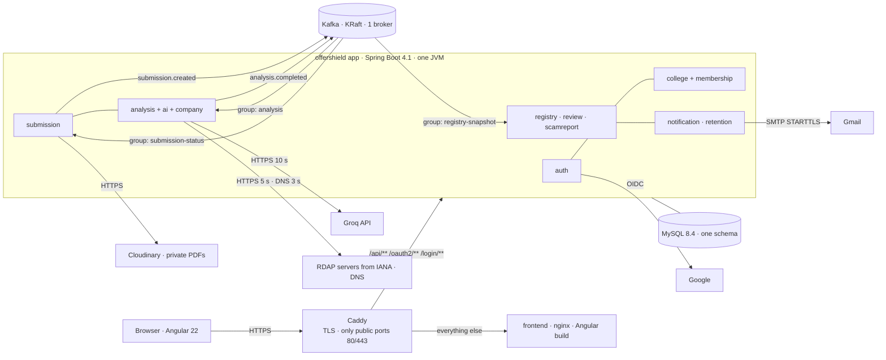
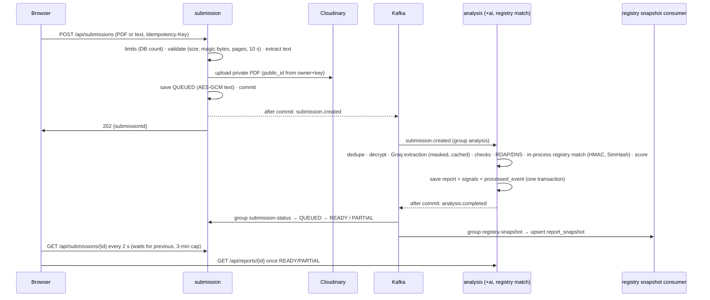
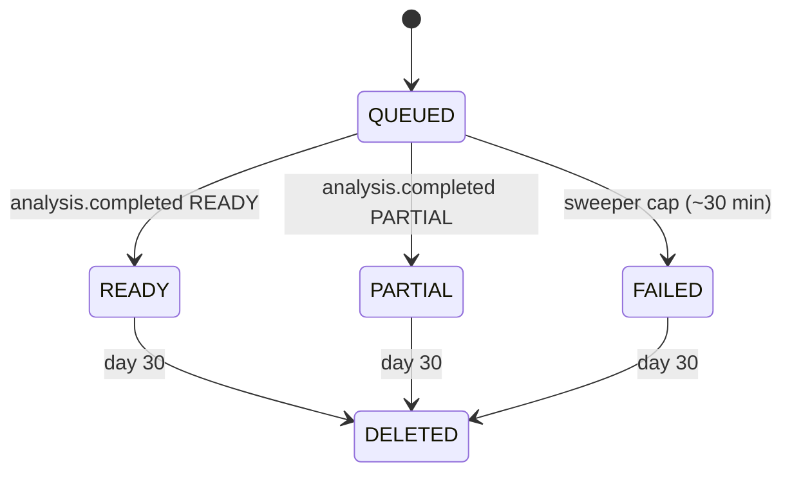

# 02 — System Architecture and ADRs (future v1 system)

**Status:** blueprint, nothing built yet. It follows the decisions in [01 §1](01-prd-review-and-open-decisions.md): **one Spring Boot app plus Kafka** (D-16), not the PRD's 4 microservices. The PRD's features, checks, data and security rules are kept except where a decision says otherwise.

---

## 1. Topology



- Only **Caddy** publishes ports. The app, MySQL and Kafka are reachable only inside the Docker network.
- Caddy does the routing the PRD gave the gateway, both locally (`http://localhost`, M-03) and in production (`https://<name>.duckdns.org`). Browser, API and login are therefore always on **one origin**, so cookies and CSRF work the same everywhere.

## 2. Feature packages (modular monolith)

Base package `com.offershield` (M-02). Each feature owns its tables and exposes a service; other features call that service, never its repository. This keeps the PRD's boundaries (§5.3) inside one app.

| Package | Responsibility (PRD) | Owns tables |
|---|---|---|
| `auth` | Google OIDC login; provision the user by `sub`; `ADMIN_EMAILS`; TPO pre-assignment (D-02); session, CSRF, security headers; Bucket4j limit (D-12); `/api/auth/me`, logout (§6.1, §14.1–14.2) | `app_user`, `tpo_assignment` |
| `college`, `membership` | Admin creates colleges and assigns TPOs; student join request; TPO approve/reject with If-Match (§3.1 path C, §11) | `college`, `membership` |
| `submission` | Upload (PDF/text), validation, AES-GCM text, Cloudinary private PDF, Idempotency-Key, DB-count limit, publish `submission.created` after commit, sweeper, status consumer, owner reads (§4 F3, §6.2–6.3, §14.4) | `submission` |
| `analysis` | `submission.created` consumer; checks C1–C6, C8–C12; SSRF guard; RDAP/DNS clients; scoring; report; publish `analysis.completed`; SimHash computation (§7, §10.1) | `report`, `signal` |
| `ai` | Groq model chain, 429 handling, redaction (D-07), extraction, cache, "Explain simply" (§8) | `llm_cache` |
| `company` | Admin-only global known-company list (D-24) | `known_company`, `known_company_domain` |
| `registry` | `analysis.completed` snapshot consumer; indicators; HMAC; exact + SimHash matching; shared-domain guard (D-08); revert (D-13) (§4 F7, §10.1) | `report_snapshot`, `indicator`, `indicator_reporter` |
| `scamreport` | Report scam; admin queue confirm/reject; PDF download link for admin (§6.4, D-05) | `scam_report` |
| `review` | Ask my TPO; TPO queue/decision with If-Match; PDF download link for TPO (§6.5, D-05) | `review_case` |
| `notification` | Gmail emails sent right after commit (D-22) | — |
| `retention` | Daily 30-day cleanup (D-06) | — |
| `common` | ProblemDetail handler, `AuditLog`, `CurrentUser`, AOP logging aspect + request ID (D-27), `TextCipher`, Kafka config, `processed_event` | `audit_log`, `processed_event` |

## 3. Main flow: upload → report



## 4. Data model (one MySQL 8.4 schema, Flyway)

Conventions as in PRD §10: `BINARY(16)` UUIDs, `created_at`/`updated_at`, InnoDB, `utf8mb4`. Tables follow PRD §10, with these changes:

| Table | Change vs PRD §10 | Reason |
|---|---|---|
| `college_domain`, `roster_entry` | **Removed** | D-17 |
| `membership.method` | Removed (always MANUAL) | D-17 |
| `tpo_assignment(email UNIQUE, college_id, assigned_by)` | **Added** | D-02 |
| `submission` | + `publish_attempts`, `last_published_at`; statuses `QUEUED/READY/PARTIAL/FAILED/DELETED` | D-28, D-06 |
| `report` | + `sender_domain`, `simhash`, `phone_hmacs`, `upi_hmacs`, `indicators_complete` | Re-send fix (D-28) |
| `known_company.college_id` | Removed (global only) | D-24 |
| `report_snapshot` | + `signals_json`, `indicators_complete` | D-04 |
| `scam_report` | + `version` | If-Match (§13.8) |
| `audit_log` | One shared table for every TPO/admin decision | R-E |
| `processed_event` | PK (`consumer`, `event_id`), + `processed_at` | 3 consumer groups in one app |

One DB user `offershield_app` (not root) owns the schema. Root is used only by the MySQL init script.

## 5. Kafka (D-20, D-28)

**Envelope** (JSON value; Kafka headers carry `eventId`, `eventType` and `requestId`):

```json
{ "eventId": "uuid", "eventType": "submission.created", "schemaVersion": 1,
  "occurredAt": "2026-10-19T10:00:00Z", "requestId": "uuid", "payload": { } }
```

| Topic · key · partitions | Consumers (group) | Payload v1 |
|---|---|---|
| `submission.created` · submissionId · 3 | `analysis` | submissionId, ownerUserId, collegeId?, sourceType, contentSha256, senderEmail?, extraPhone?, extraUpi? (text stays encrypted in the DB; the consumer reads it by ID) |
| `analysis.completed` · submissionId · 3 | `submission-status`, `registry-snapshot` | submissionId, ownerUserId, collegeId?, outcome (READY/PARTIAL), score, band, unavailableChecks[], signals[{code, outcome, points, explanation, evidence ≤ 200 chars, sourceKind, aiExtracted}], senderDomain?, phoneHmacs[], upiHmacs[], indicatorsComplete, simhash? |

Rules:
- **Publish** in `@TransactionalEventListener(AFTER_COMMIT)`, confirming the send. Producers use `acks=all` with idempotence on.
- **Event IDs** are deterministic: a name-based UUID of topic + submissionId.
- **Sweeper** (`@Scheduled` every 60 s): re-publish `QUEUED` rows when `last_published_at` is older than 2^(attempts+1) min (2, 4, 8, 16 min). After 4 re-publishes → `FAILED`.
- **Consumers:**
  - `ErrorHandlingDeserializer` + JSON with trusted package `com.offershield.common.events` only.
  - `DefaultErrorHandler`: 3 retries with backoff, then `<topic>.DLT`, with the resolver set **explicitly**, because the Spring Kafka 4 default is `-dlt`.
  - Bad payloads are not retried.
  - analysis uses `max.poll.records=1`.
- **Idempotency:** insert (`consumer`, `eventId`) into `processed_event` in the same transaction as the work. If analysis receives a duplicate and the report already exists, it **re-sends** `analysis.completed`.
- **Retention:** topics keep messages 3 days and DLTs 7 days (D-06). Topics and DLTs are declared as `NewTopic` beans; auto-create is off.
- **Versioning:** additive fields keep `schemaVersion`; a breaking change gets a new topic (`.v2`).

## 6. Security boundaries

- **Login (D-21):** Spring Security `oauth2Login` with Google (state, nonce and PKCE are defaults in Security 7). The user is provisioned by `sub`; verified-email rules follow R-C.
- **Session cookie:** `JSESSIONID`, HttpOnly; Secure; SameSite=Lax; lifetime per M-04.
- **Logout:** invalidates the session.
- **`/api/**`:** returns a 401 ProblemDetail instead of redirecting to Google.
- **CSRF:** `http.csrf(c -> c.spa())`. The `XSRF-TOKEN` cookie is readable by JS and Angular echoes it automatically (relative URLs only).
- **Authorization:** role checks (USER/TPO/ADMIN) per endpoint, plus **scoped queries** (`findByIdAndOwnerUserId`, `findByIdAndCollegeId`). Other users' data → 404. No identity is ever read from request headers.
- **Rate limits:** DB counts for uploads (5/10 min) and scam reports (5/day). Bucket4j 60 req/min per signed-in user → 429.
- **Data:** AES-256-GCM for letter text (random 12-byte IV, `key_version`, AAD = submissionId); HMAC-SHA256 with a pepper for phones and UPI IDs; masked text to Groq (D-07); no PII in logs (D-27).
- **SSRF:** only a validated domain (no IP literals, ports, paths or localhost; IDN → ASCII) reaches RDAP/DNS. RDAP hosts come only from the IANA bootstrap. URLs inside letters are never fetched.
- **Headers (Spring Security):** CSP per D-10; HSTS (prod); nosniff; `frame-ancestors 'none'`; Referrer-Policy. Actuator exposes `health` only.

## 7. State machines



| Machine | Transitions |
|---|---|
| Membership | (request) → PENDING → APPROVED / REJECTED, by the TPO of that college, with If-Match and a reason required to reject · REJECTED → PENDING when the student re-applies (D-33.3) |
| Review case | OPEN → CONFIRMED_SCAM / CONFIRMED_GENUINE / INCONCLUSIVE, by the TPO of that college with If-Match (409 if stale). CONFIRMED_SCAM ⇒ the snapshot's markers become CONFIRMED, except shared domains (D-08) |
| Scam report | OPEN → CONFIRMED / REJECTED by the admin with If-Match. Confirm ⇒ markers CONFIRMED; reject ⇒ D-33.4 |
| Indicator | → UNVERIFIED (scam report) → CONFIRMED (admin or TPO) → UNVERIFIED (admin **Revert**, D-13, audited) · UNVERIFIED with no reporters → REJECTED (stops counting) · REJECTED → UNVERIFIED (new distinct reporter) |

## 8. Failure handling

| Dependency | Timeout | On failure | User sees |
|---|---|---|---|
| Groq | 10 s per model | Next model; a 429 marks it exhausted until `retry-after`/reset; all fail → rules only | "AI unavailable", PARTIAL |
| RDAP | 5 s; Caffeine 24 h | C5 `UNAVAILABLE` | PARTIAL, check named |
| DNS | 3 s; Caffeine 1 h | C6 `UNAVAILABLE` | PARTIAL, check named |
| Cloudinary | 15 s | 503, no submission row | "Upload failed, try again" |
| Kafka publish | confirmed send | Row stays QUEUED; the sweeper re-sends; FAILED after the cap | "Processing…", then "Couldn't analyse" |
| Consumer error | 3 retries | `.DLT` (bad payloads go straight there) | FAILED via the sweeper cap |
| Gmail | 10 s | Logged; the decision still stands | Email late or missing |
| MySQL | pool 5 s | 503; consumers retry | Error page / retry |

## 9. Frontend

- **Structure:**
  - `core/auth`: a session store loaded once from `/api/auth/me`; `authGuard`; `roleGuard(role)` used as `canMatch`.
  - `core/http`: one interceptor (401 → `/login`).
  - `shared/ui`: risk badge, problem alert, live status.
  - Lazy feature areas `/app`, `/tpo`, `/admin`.
- **Conventions:** standalone components + signals + `@if`/`@for`. Relative `/api` URLs (built-in XSRF). Plain-text rendering only (no `[innerHTML]`).
- **Polling (D-14):** `timer` + `exhaustMap` + `takeWhile` on `/api/submissions/{id}`, with a 3-min cap.
- **Look (D-26):** clean custom CSS with a calm "offer-letter" style.
  - The risk band is shown by word + shape + colour (Low ○, Medium △, High ⬣).
  - "Reported as a scam by N users (not verified)" is a neutral chip, distinct from "Confirmed scam".
  - Fonts are self-hosted or a system stack.
  - The copy never says "verified" or "safe".
- **UX rules (web-design-guidelines):**
  - One `role=status` live region announces state changes.
  - Focus moves to the `<h1>` on route change.
  - Touch targets ≥ 44 px.
  - Use `en-IN` formats for ₹ amounts and dates.

## 10. Deployment

| | Local | OCI production (D-23) |
|---|---|---|
| Entry | `http://localhost` (Caddy) | `https://<name>.duckdns.org` (Caddy, automatic TLS) |
| Containers | caddy, frontend, app, mysql, kafka | Same, built on the VM (arm64) |
| Ports | Caddy `:80`, bound to `127.0.0.1` | Caddy 80/443 only |
| Memory | dev defaults | M-09: app 1 GB, MySQL 1.5 GB, Kafka 1 GB, Caddy + nginx 128 MB ≈ 3.7 GB of 12 GB |
| Logs | `./logs` volume (D-27) | Same, plus Docker json-file rotation |

## 11. Capacity (estimates)

| Quantity | Estimate |
|---|---|
| AI analyses | About 230–300/day on Groq's free tier, then rule-only. Bursts are limited to about 4 calls/min per model |
| Analysis time | 3–15 s typical, about 40 s worst case (3 Groq timeouts + RDAP + DNS) |
| Storage | Bounded by the 30-day retention (≈ 2 GB of MySQL at the PRD's maximum); Cloudinary ≈ 12 of 25 credits at the PRD's maximum |
| Email | Gmail allows ≤ 500 per day |
| Bottlenecks, in order | Groq quota → single VM (no backup, K-08) → Gmail limit |

## 12. Architecture decision records

| ADR | Decision | Why | Trade-off | Revisit when |
|---|---|---|---|---|
| ADR-001 | One Spring Boot app with feature packages + Kafka (D-16) | Easier to understand, build and run on one VM; keeps Kafka learning | No independent scaling or deployment per feature | Real traffic needs one feature scaled separately |
| ADR-002 | Kafka with 2 topics and fan-out (D-20) | Async analysis; shows pub/sub with 2 consumer groups | Two "save then publish" points → sweeper + re-send fix (D-28) | Duplicates cause harm → transactional outbox |
| ADR-003 | Spring session cookie, not your own JWT (D-21) | Least code; Spring handles it; logout really ends the session | A restart logs users out; one instance only | Multiple app instances → Spring Session JDBC |
| ADR-004 | Caddy is the only public entry, and also routes (D-16, D-23) | Same origin for app and API; automatic HTTPS | — | — |
| ADR-005 | Deterministic Java scoring; AI only extracts and explains (§2.1) | Explainable; prompt injection can't flip the verdict | Weights unvalidated (§19.2) | After labelled TPO/admin decisions exist |
| ADR-006 | One `RestClient`-based client for Groq's OpenAI-compatible API (§8.2, D-11) | Simple; full control over 429 handling | Groq-only capacity | Paid tier or a second free provider |
| ADR-007 | SimHash computed in `analysis`; HMAC pepper used only by `registry` code (D-18) | Clear ownership even inside one app | — | — |
| ADR-008 | Timeouts + caching instead of circuit breakers (D-31) | One less library; one app has no internal network calls | A slow RDAP server costs up to 5 s per analysis | Many RDAP timeouts in the logs |
| ADR-009 | Private Cloudinary PDFs with short-lived links for the TPO/admin only (D-05) | Reviewers can see the original; nothing is public | Download links bill 2× bandwidth | Free credits run low |

## 13. Design check (`/design` quick diagnostic, after the decisions)

- **Better than the PRD on failure handling:** one JVM, no internal network calls, and fixed Kafka gaps (D-28).
- **Weakest point:** the single VM with no backups (K-08). This is a known limitation, not hidden.
- **Next bottleneck:** the Groq free quota.
- **At 10× load:** a paid AI tier, a transactional email provider, the outbox.
- **At 100× load:** split the analysis feature into its own service (the package boundaries already allow it), plus managed MySQL and Kafka.
