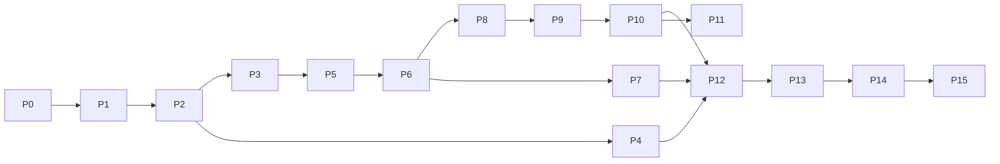

# 03 — Implementation Roadmap

**Baseline:** the PRD §17 build order, adapted to the approved decisions ([01 §1](01-prd-review-and-open-decisions.md)): one app plus Kafka (D-16), and a flexible schedule of about one week (D-15).
**Rules:**
- One phase per session, each ending with "run it" and a 15-minute explain-it checkpoint.
- Never "build everything".
- Never skip security items.
- **Ask the phase's M-items before coding** (user rule: no silent decisions).

**Task detail:** [04](04-work-breakdown.md) · **Prompts:** [07](07-phase-execution-prompts.md)

---

## 1. Phases, milestones, estimates

| Phase | PRD block | Asks first | Milestone / done when | Est (P50 h) |
|---|---|---|---|---|
| **P0** Accounts, secrets, seed list | — | — | `.env` ready; Groq account works or the result is recorded; company domains verified | 2.0 (user) |
| **P1** Foundation | H0–2 | M-01, M-02, M-03 | **M1:** compose healthy; Flyway works on MySQL 8.4; logs written to `logs/` without arguments; CI file present | 3.5 |
| **P2** Login and security | H2–8 | M-04 | **M2:** Google sign-in at `http://localhost`; `/api/auth/me` shows the role; CSRF, headers and the 60/min limit proven by tests | 4.0 |
| **P3** Colleges and membership | H8–10 | — | Admin creates a college and assigns a TPO; a student requests to join; the TPO approves; the email arrives; a stale decision → 409 | 2.5 |
| **P4** Angular shell | H10–11 | M-05 | **M3:** login → choose path → join college works in the browser | 3.0 |
| **P5** Submission | H24–27 | — | Upload → 202 → event visible in Kafka; private PDF in Cloudinary (V-10 tested) | 5.0 |
| **P6** Analysis core | H27–31, H34–35 | M-06 | **M4:** a "pay ₹5,000 deposit" letter → High with evidence; status READY/PARTIAL through fan-out | 7.0 |
| **P7** AI (Groq) | H31–34 | — | AI fills fields; a bad key → "AI unavailable"; injection test green | 4.0 |
| **P8** Companies and lookalikes | H34–35 | — | **M5:** `inf0sys-careers.com` flagged | 2.0 |
| **P9** Registry | H48–51 | — | A scam confirmed at user A is flagged for user B; SimHash and copied-letter tests green | 4.5 |
| **P10** Scam reports, reviews, PDF links | H51–53 | M-07 | **M6:** "Reported by 1 user (not verified)" → admin confirms → the next match is High; TPO review with 409 on a race; Revert works; emails arrive | 4.5 |
| **P11** Retention | (F10) | — | The daily job cleans everything older than 30 days | 1.0 |
| **P12** Angular screens | H53–57 | M-08 | Every role can do its job in the UI (12 screens) | 6.5 |
| **P13** Test and security gate | H57–59 | — | **M7:** all mandatory tests and proofs passed, with evidence | 2.0 |
| **P14** Deploy on OCI | H59–62 | M-09, M-10 | A friend signs in from a phone and gets a report | 3.5 |
| **P15** README | H62–63 | — | **M8:** pushed to GitHub | 1.0 |
| | | | **Total** | **≈ 54 h** + ≈ 3.5 h checkpoints ≈ **58 h** |

**Realistic calendar (D-15):** about 6 days at 10 focused hours, or about 7 days at 8 hours. The ranges in 04 give a spread of roughly 45–75 h. These are estimates only; re-estimate after M1 using the real P1 time.

| Day | Phases | Milestones |
|---|---|---|
| 1 | P1, P2 | M1, M2 |
| 2 | P3, P4, start P5 | M3 |
| 3 | finish P5, P6 | M4 |
| 4 | P7, P8, P9 | M5 |
| 5 | P10, P11, start P12 | M6 |
| 6 | finish P12, P13 | M7 |
| 7 | P14, P15, buffer | M8 |

## 2. First milestone (M1) — acceptance criteria

1. `mvn -B -f backend/pom.xml verify` is green.
2. `docker compose up -d --build` → caddy, app, mysql and kafka are all `healthy`.
3. Only Caddy publishes a port (`127.0.0.1:80`); `docker compose port app 8080` prints nothing.
4. Flyway applied `V1__baseline` on `mysql:8.4` (proves V-25).
5. One request writes `logs/offershield.log` lines containing `requestId`, `class.method` and duration, and the `neverLogsArguments` test passes.
6. `.env` is git-ignored; `.env.example` lists every variable; the CI workflow (build + gitleaks) and Dependabot files exist. CI runs once a GitHub remote exists.

## 3. Critical path and risks

| Rank | Risky work | Early warning | What to do |
|---|---|---|---|
| 1 | P2: Google login + session + CSRF with Angular | `CsrfTest` red, or a redirect URI mismatch | Use Spring's `csrf.spa()` recipe; check the redirect URI exactly; time-box to 2× |
| 2 | P5/P6: Kafka reliability (two "save then publish" points) | Duplicate or stuck submissions in tests | D-28 tests first (TDD) |
| 3 | P12: 12 screens | P12-01 takes > 2 h | Build the shared UI pieces first; use the PRD cut list (§4) if needed |
| 4 | P14: OCI setup | VM won't create; ports closed | 06 §4 runbook; any ~4 GB Linux VM as a fallback |

## 4. If you fall behind (recovery)

**Time-box rule:** if a phase takes more than **2× its estimate**, stop, debug the blocker (`superpowers:systematic-debugging`), and tell the user. Never claim "done" without test output.

**The PRD §17 cut order, adapted to the decisions.** Each step needs the user's OK at the time:

| # | Cut | Saves |
|---|---|---|
| 1 | "Explain simply" button (P7-03 + its button) | ~1.25 h |
| 2 | Known-company admin screen; keep the seed migration (part of P12-04) | ~0.5 h |
| 3 | *(Roster CSV: already removed by D-17)* | — |
| 4 | TPO review-decision email (part of P10-03) | ~0.25 h |

**Never cut:** SSRF guard, IDOR scoping, file validation, AI fallback-to-none, every §14 control (D-25), the PRD §18 tests, idempotent consumers, and the D-08/D-09 false-accusation guards.

## 5. Understanding checkpoints (15 minutes after each phase)

| After | Must understand |
|---|---|
| P1 | What each container does; why only Caddy is public; what the AOP logger records and refuses to record |
| P2 | The OAuth Authorization Code flow (state, nonce, PKCE); session cookie + CSRF token; why identity never comes from headers |
| P3 | The membership state machine; `If-Match` and 409; why emails are sent after commit |
| P4 | Guards vs server-side checks; Angular's automatic XSRF header |
| P5 | Idempotency keys; publish after commit + sweeper; AES-GCM IV and AAD |
| P6 | At-least-once delivery + idempotent consumers; fan-out with two consumer groups; SSRF; hard overrides |
| P7 | The model fallback chain; why AI can't change the score; masking |
| P8–P9 | Look-alike rules; HMAC vs SHA-256; SimHash; why unverified reports never override |
| P10 | Optimistic locking; trust levels; who may download a PDF |
| P13 | "Test executed" vs "test passed" |
| P14 | Your memory budget; how to move the app to another host |

**Understand later:** Kafka partition rebalancing, transactional outbox (upgrade), session clustering.

## 6. Deviations from the PRD build sequence (all approved via the decisions)

| Deviation | Reason |
|---|---|
| H6–8 "gateway" is replaced by in-app security config (P2-03) | D-16: no gateway |
| Tests are written inside each task (TDD); H57–59 becomes a gate (P13) | Earlier bug detection; same tests |
| P11 retention phase added | F10 needs it; the PRD's schedule never placed it |
| P0 user tasks before coding | Accounts and the seed list need you |
